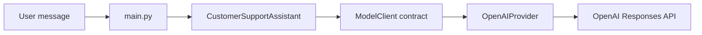

# ai-agent-py

A Python customer support agent built as a staged LLM engineering project. The codebase
progresses from a single provider-backed assistant to layered components for prompts,
structured output, tool orchestration, conversation state, and long-term memory.

Python 3.12+ and `uv` are required.

## Quick Start

```bash
uv sync
cp .env.example .env
```

Set `OPENAI_API_KEY` and `OPENAI_MODEL` in `.env`, then run the sample assistant:

```bash
uv run ai-agent-py
```

`.env` is ignored by Git. Never commit API keys or other credentials.

## Commands

| Command | Purpose |
| --- | --- |
| `uv sync` | Install runtime and development dependencies |
| `uv run ai-agent-py` | Run the sample single-turn support assistant |
| `uv run pytest -q` | Run the full test suite |
| `uv run ruff check .` | Lint the repository |
| `uv run ruff check <path>` | Lint a specific changed file or directory |

The entry point currently runs `CustomerSupportAssistant`. The tool orchestrator and
conversation components are available as modules but are not yet wired into the CLI.

## Architecture



The wider application is organized into these layers:

| Layer | Responsibility |
| --- | --- |
| Entry point | Configure and run the application |
| Application services | Coordinate requests, retries, parsing, tools, conversations, and memory |
| Domain models | Define shared request, response, ticket, conversation, and memory data |
| Prompts | Build and version ticket classification prompts |
| Providers | Adapt provider-specific APIs to the `ModelClient` contract |
| Tools | Register, validate, and dispatch controlled application tools |

## Conversation State

Day 75 added the foundations for multi-turn conversations:

- `src/ai_agent/domain/conversation.py` defines `MessageRole`, `Message`, `Conversation`,
  and `ConversationMemory`.
- `src/ai_agent/application/conversation_store.py` persists conversations, messages, and
  structured memory in SQLite.
- `src/ai_agent/application/context_manager.py` estimates tokens, enforces a context budget,
  removes the oldest history first, and raises `ContextWindowExceeded` when fixed content
  cannot fit.
- `src/ai_agent/application/conversation_manager.py` provides the facade for starting
  conversations, adding messages, updating memory, and building model-ready context.

```python
from ai_agent.application.context_manager import ContextManager
from ai_agent.application.conversation_manager import ConversationManager
from ai_agent.application.conversation_store import ConversationStore

store = ConversationStore("conversations.db")
manager = ConversationManager(store=store, context_manager=ContextManager())

conversation_id = manager.start_conversation()
manager.add_user_message(conversation_id, "My order #4821 has not arrived.")

context = manager.build_context(
    conversation_id=conversation_id,
    system_prompt="You are a support assistant.",
    current_message="Can you check its status?",
)
```

The default context manager uses a 32,000-token limit, reserves 4,000 tokens for the
response, and estimates tokens as `ceil(len(text) / 4)` plus per-message overhead. History
and memory are supporting context, not authoritative business state; order status,
permissions, and workflow state must still come from tools, databases, or application code.

Integration with `AgentOrchestrator` and the five-turn support lab are the next wiring
steps. Automatic summarization of evicted history is not implemented yet.

## Long-Term Memory (Day 76)

Day 76 extends conversation state with summarization, structured memory, and retrieval. Memory
processing stays behind interfaces so storage and LLM details do not leak into the coordination
layer:

| Component | File | Responsibility |
| --- | --- | --- |
| `MemoryFact` / `LongTermMemory` | `src/ai_agent/domain/memory.py` | Validate owner-scoped facts with confidence, source, and timestamps |
| `MemorySummarizer` | `src/ai_agent/application/memory_summarizer.py` | Define the summarization interface |
| `LLMMemorySummarizer` | `src/ai_agent/application/llm_memory_summarizer.py` | Produce concise, factual summaries through `ModelClient` |
| `MemoryExtractor` | `src/ai_agent/application/memory_extractor.py` | Define the fact-extraction interface |
| `TicketMemoryExtractor` | `src/ai_agent/application/ticket_memory_extractor.py` | Extract order, issue, and preference facts deterministically |
| `MemoryRetriever` | `src/ai_agent/application/memory_retriever.py` | Select relevant facts with a keyword baseline |
| `MemoryManager` | `src/ai_agent/application/memory_manager.py` | Coordinate summarization, extraction, persistence, and retrieval |

`ConversationStore` adds a `long_term_memories` table keyed by `(owner_id, memory_key)`, with
upsert, retrieval, and delete operations. Owner IDs must come from authenticated application
context, and retrieved memories must be treated as untrusted data rather than instructions.

The target context order is system instructions, relevant long-term facts, conversation
summary, recent history, and current request. Context assembly, automatic summarization
triggers, and orchestrator integration are still planned. Repeated facts already update the
existing record by key; user corrections replace stale values.

The Day 76 design is documented in `docs/SUMMARY.md`. Implemented tests cover memory
validation, extraction, retrieval, restart persistence, duplicate updates, and manager
behavior with fake collaborators. There is no dedicated `LLMMemorySummarizer` test yet.

## Project Layout

```text
src/ai_agent/
├── application/     # Services, model client, orchestrator, conversation and memory services
├── domain/          # Shared request, response, ticket, conversation, and memory models
├── prompts/         # Prompt templates, registry, and builder
├── providers/       # Provider adapters
├── tools/           # Tool schemas, registry, dispatcher, and implementations
├── config.py        # Environment configuration
└── main.py          # CLI entry point

tests/               # Unit tests using mocks and temporary SQLite databases
docs/SUMMARY.md      # Condensed lesson summaries
LOG.md               # Development log
```

## Verification

The full test suite currently reports `52 passed` with `uv run pytest -q`. Conversation and
memory tests use temporary SQLite databases and fake collaborators, so they require no API
credentials or live model calls. Changed implementation files pass Ruff; repository-wide
linting still reports pre-existing findings in unrelated modules. No static typechecker is
configured.

## Documentation

- `docs/SUMMARY.md` — lesson-by-lesson design notes
- `LOG.md` — implementation log and next steps
