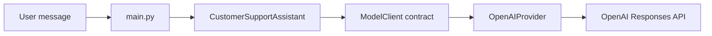

# ai-agent-py

A Python customer support agent built as a staged LLM engineering project. The codebase
progresses from a single provider-backed assistant to layered components for prompts,
structured output, tool orchestration, conversation state, long-term memory, and response
streaming.

Python 3.12+ and `uv` are required.

## Quick Start

```bash
uv sync
cp .env.example .env
```

Set `OPENAI_API_KEY` and `OPENAI_MODEL` in `.env`, then run the sample assistant:

```bash
uv run ai-agent-py
```

`.env` is ignored by Git. Never commit API keys or other credentials.

## Commands

| Command | Purpose |
| --- | --- |
| `uv sync` | Install runtime and development dependencies |
| `uv run ai-agent-py` | Run the sample single-turn support assistant |
| `uv run pytest -q` | Run the full test suite |
| `uv run ruff check .` | Lint the repository |
| `uv run ruff check <path>` | Lint a specific changed file or directory |

The entry point currently runs `CustomerSupportAssistant`. The tool orchestrator and
conversation components are available as modules but are not yet wired into the CLI.

## Architecture



The wider application is organized into these layers:

| Layer | Responsibility |
| --- | --- |
| Entry point | Configure and run the application |
| Application services | Coordinate requests, retries, parsing, tools, conversations, memory, and streaming |
| Domain models | Define shared request, response, ticket, conversation, and memory data |
| Prompts | Build and version ticket classification prompts |
| Providers | Adapt provider-specific APIs to the `ModelClient` contract |
| Tools | Register, validate, and dispatch controlled application tools |

## Conversation State

Day 75 added the foundations for multi-turn conversations:

- `src/ai_agent/domain/conversation.py` defines `MessageRole`, `Message`, `Conversation`,
  and `ConversationMemory`.
- `src/ai_agent/application/conversation_store.py` persists conversations, messages, and
  structured memory in SQLite.
- `src/ai_agent/application/context_manager.py` estimates tokens, enforces a context budget,
  removes the oldest history first, and raises `ContextWindowExceeded` when fixed content
  cannot fit.
- `src/ai_agent/application/conversation_manager.py` provides the facade for starting
  conversations, adding messages, updating memory, and building model-ready context.

```python
from ai_agent.application.context_manager import ContextManager
from ai_agent.application.conversation_manager import ConversationManager
from ai_agent.application.conversation_store import ConversationStore

store = ConversationStore("conversations.db")
manager = ConversationManager(store=store, context_manager=ContextManager())

conversation_id = manager.start_conversation()
manager.add_user_message(conversation_id, "My order #4821 has not arrived.")

context = manager.build_context(
    conversation_id=conversation_id,
    system_prompt="You are a support assistant.",
    current_message="Can you check its status?",
)
```

The default context manager uses a 32,000-token limit, reserves 4,000 tokens for the
response, and estimates tokens as `ceil(len(text) / 4)` plus per-message overhead. History
and memory are supporting context, not authoritative business state; order status,
permissions, and workflow state must still come from tools, databases, or application code.

Integration with `AgentOrchestrator` and the five-turn support lab are the next wiring
steps. Automatic summarization of evicted history is not implemented yet.

## Long-Term Memory (Day 76)

Day 76 extends conversation state with summarization, structured memory, and retrieval. Memory
processing stays behind interfaces so storage and LLM details do not leak into the coordination
layer:

| Component | File | Responsibility |
| --- | --- | --- |
| `MemoryFact` / `LongTermMemory` | `src/ai_agent/domain/memory.py` | Validate owner-scoped facts with confidence, source, and timestamps |
| `MemorySummarizer` | `src/ai_agent/application/memory_summarizer.py` | Define the summarization interface |
| `LLMMemorySummarizer` | `src/ai_agent/application/llm_memory_summarizer.py` | Produce concise, factual summaries through `ModelClient` |
| `MemoryExtractor` | `src/ai_agent/application/memory_extractor.py` | Define the fact-extraction interface |
| `TicketMemoryExtractor` | `src/ai_agent/application/ticket_memory_extractor.py` | Extract order, issue, and preference facts deterministically |
| `MemoryRetriever` | `src/ai_agent/application/memory_retriever.py` | Select relevant facts with a keyword baseline |
| `MemoryManager` | `src/ai_agent/application/memory_manager.py` | Coordinate summarization, extraction, persistence, and retrieval |

`ConversationStore` adds a `long_term_memories` table keyed by `(owner_id, memory_key)`, with
upsert, retrieval, and delete operations. Owner IDs must come from authenticated application
context, and retrieved memories must be treated as untrusted data rather than instructions.

The target context order is system instructions, relevant long-term facts, conversation
summary, recent history, and current request. Context assembly, automatic summarization
triggers, and orchestrator integration are still planned. Repeated facts already update the
existing record by key; user corrections replace stale values.

The Day 76 design is documented in `docs/SUMMARY.md`. Implemented tests cover memory
validation, extraction, retrieval, restart persistence, duplicate updates, and manager
behavior with fake collaborators. There is no dedicated `LLMMemorySummarizer` test yet.

## Streaming Responses (Lesson Day 73)

Day 73 adds incremental response delivery so users see generated text as chunks arrive
instead of waiting for the complete model response. Streaming improves perceived
responsiveness; it does not necessarily reduce total generation time or token cost.

| Component | File | Current state |
| --- | --- | --- |
| `ModelClient.stream()` | `src/ai_agent/application/model_client.py` | Declares an `Iterator[str]` chunk stream |
| `OpenAIProvider.stream()` | `src/ai_agent/providers/openai_provider.py` | Partial implementation; still needs event iteration, yields, and provider error handling |
| `Assistant.ask_stream()` | `src/ai_agent/application/assistant.py` | Relays chunks from the model client |
| Streaming tests | `tests/application/test_streaming.py` | Verify chunk delivery and reconstruction with a fake client |

Provider-specific event handling belongs in `providers/`, while the application layer depends
only on the `ModelClient` contract. The non-streaming `CustomerSupportAssistant.answer()` path
is preserved. Partially streamed JSON must not be used as a trusted classification result;
collect, parse, and validate the complete response first.

Production streaming also needs cancellation, connection and read timeouts, TTFT and
completion observability, bounded buffers for backpressure, sanitized error messages, and
logging that avoids sensitive generated content.

The current streaming implementation is incomplete: the provider method does not import
`Iterator`, uses undefined `self.model`, and does not iterate or yield events. Its annotation
currently breaks full-suite collection. The new string-based `ModelClient` contract also
conflicts with the existing `ModelRequest`/`ModelResponse` interface used by the rest of the
application.

## Model Parameters (Lesson Day 74)

Lesson Day 74 defines how generation settings should be selected and centralized. Ticket
classification needs low variation, a controlled output budget, valid JSON, and confirmed
completion. Conversational or creative tasks can use higher temperature and a larger token
budget, but the same configuration must not be applied to every task.

| Parameter | Purpose |
| --- | --- |
| `temperature` | Controls randomness in token selection |
| `top_p` | Limits sampling to the nucleus of likely tokens |
| `max_output_tokens` | Caps generated output length and cost |
| `frequency_penalty` | Reduces repeated tokens |
| `presence_penalty` | Encourages new topics or vocabulary |
| `stop` | Stops generation at a configured sequence |

Temperature and top-p support varies by model; usually tune one at a time. Explicit zero
values must be preserved, while unsupported `None` values must be omitted rather than sent to
the provider. A small token budget can truncate JSON, so response status and completion must be
checked before parsing.

The target design separates task selection from provider parameters: task profiles select a
frozen `GenerationConfig`, a builder omits `None` values, and the provider translates the
result into API options. Local commits add `GenerationConfig`, `build_generation_options()`,
four task profiles, and builder tests. The profiles currently live in
`src/ai_agent/config/generation_profiles.py`, but they cannot be imported because
`src/ai_agent/config.py` resolves as a module instead of a package. Provider integration is
not implemented; `ModelRequest` still exposes only `max_output_tokens`.

Parameter choices must be validated with repeated trials across a representative dataset.
Record JSON validity, correctness, completion, response length, latency, and token usage before
selecting a production profile.

## Model Selection (Lesson Day 75)

Model choice must be based on the application's requirements, not raw model size or benchmark
rankings. Evaluate quality on a representative ticket dataset, then compare latency (TTFT, TTLT,
inter-token, and end-to-end), cost, context-window fit, required capabilities, reliability,
deployment constraints, and security/compliance requirements.

| Dimension | Main question |
| --- | --- |
| Quality | Does the model meet task-specific accuracy, JSON, RAG, reasoning, and tool-call targets? |
| Latency | Does it meet interactive and total-response targets under realistic load? |
| Cost | What are input, output, cached-input, retry, and infrastructure costs at expected volume? |
| Context | Can prompts, history, retrieved documents, current input, and reserved output fit? |
| Capabilities | Are streaming, structured output, tools, vision, audio, reasoning, or embeddings required? |
| Reliability | Are availability, errors, timeouts, rate limits, and version changes acceptable? |
| Deployment | Is cloud, self-hosted, or hybrid operation required? |
| Security/compliance | Are retention, residency, encryption, access, audit, and data terms acceptable? |

The proposed project targets are at least 95% classification accuracy, at least 99% structured
output validity, average latency under 2 seconds, required tool calling, an approved provider,
and human approval before consequential actions. These are targets, not measured results.

Cost can be estimated as `(input_tokens / 1,000,000) × input_price + (output_tokens /
1,000,000) × output_price`. At 10,000 tickets per day with 1,000 input tokens and 300 output
tokens per ticket, hypothetical $2/$8 per-million prices produce about `$44/day` or `$1,320` per
30 days before retries, caching, and infrastructure.

Local commits implement a frozen `ModelDefinition`, a `ModelRegistry` with duplicate and
unknown-model validation, a task-based `ModelSelector`, a candidate catalog, and six registry/
selector tests that pass. Capability flags and context limits must still be verified against
provider documentation; the catalog's placeholder model IDs and `context_window=0` are not
production values. `src/ai_agent/config/model_catalog.py` cannot currently be imported because
`src/ai_agent/config.py` is a module while `src/ai_agent/config/` lacks `__init__.py`.

Routing simple, medium, and complex work to different models can optimize cost and quality, but
selection must come from measured performance with fallback and observability. Selection is not
wired into the application, and `experiments/model-selection.md` does not exist yet.

## Local LLM Inference (Lesson Day 76)

Ollama can run an instruct model locally and expose it through `http://localhost:11434/api/chat`.
This keeps inference on controlled infrastructure and avoids cloud connectivity, API billing,
external data processing, and provider rate limits. It adds responsibility for hardware, model
downloads, runtime updates, scaling, monitoring, and runtime security.

| Concept | Meaning |
| --- | --- |
| Inference | Uses existing model weights to generate responses |
| Ollama | Local runtime, model manager, CLI, and HTTP API |
| GGUF/llama.cpp | Common local model format and efficient inference runtime |
| Quantization | Lower-precision weights that reduce memory but can reduce quality |
| GPU/CPU | Hardware that accelerates inference or runs it without a dedicated GPU |

A quantized 8B model has theoretical weight storage of roughly 32 GB (FP32), 16 GB (FP16),
8 GB (INT8), or 4 GB (4-bit). Actual memory also includes metadata, KV cache, and runtime
overhead, so a 4-bit model does not necessarily fit in 4 GB of RAM or VRAM.

The target provider uses `Client(host=OLLAMA_BASE_URL)`, calls `client.chat()` with `stream=False`
for complete responses, and yields chunk content when `stream=True`. `ModelClient` remains the
shared interface, while `LLM_PROVIDER`, `OLLAMA_MODEL`, and `OLLAMA_BASE_URL` select and configure
the provider through a factory. Ollama generation needs no OpenAI API key, and `.env` must stay
out of Git.

Unit tests should mock the Ollama client so Ollama does not need to run for the suite. Cloud and
local inference should then be compared on the same ticket dataset using quality, JSON validity,
average/P95 latency, token usage, infrastructure cost, RAM/VRAM usage, and tool-calling support.
Local inference is not automatically secure; restrict the runtime API to trusted access.

An `OllamaProvider` with `generate()` and a yielding `stream()` exists, but the `ollama` package
is missing from `pyproject.toml`, so the provider cannot be imported yet. There is no provider
factory, provider configuration, mocked-provider test, or local-inference evaluation file yet.
The current string-based `ModelClient` also conflicts with the application's
`ModelRequest`/`ModelResponse` code, and the full suite remains blocked by the separate
`OpenAIProvider.stream()` `Iterator` import error.

## LLM Application Architecture Patterns (Lesson Day 77)

The target design avoids a monolithic `process_ticket()` function by separating domain,
application, prompt, provider, tool, validation, and infrastructure responsibilities. High-level
workflow code should depend on a `ModelClient` interface instead of the OpenAI SDK or Ollama
client; provider adapters implement that interface, so the orchestrator can switch providers,
use local models in development, support fallback, and be tested with fakes.

| Pattern | Purpose |
| --- | --- |
| Layered architecture | Separate domain, application, interfaces, providers, tools, validation, and infrastructure |
| Dependency inversion | Make orchestration depend on abstractions, not provider implementations |
| Ports and adapters | Isolate OpenAI, Ollama, databases, and other external systems |
| Orchestration | Coordinate prompt → model → parse → validate → route → result |
| Strategy and registry | Swap providers and centralize model/tool configuration |
| Guardrails and human approval | Validate outputs and control consequential actions |
| Observability and configuration | Track execution and change providers/models without code edits |

Dependencies such as the model client, prompt builder, parser, validator, and tool dispatcher
should be injected from a composition root. The orchestrator coordinates those components; it
should not create SDK clients, read API keys, embed provider HTTP logic, access storage directly,
or duplicate validation rules. The domain must not depend on OpenAI, Ollama, FastAPI, or database
infrastructure.

The project already has many separated components: domain models, application services, prompt
builder/registry, response parser, retry/errors, provider files, tool registry/dispatcher/executor,
and a `ModelClient` protocol. The refactor is incomplete: `AgentOrchestrator` still creates
`OpenAI` directly, reads `OPENAI_MODEL`, embeds prompt instructions, and builds its own tool
registry. There is no provider factory, no orchestrator unit test, and no full architecture
review recorded. String-based and `ModelRequest`/`ModelResponse` interfaces coexist.

## Project Layout

```text
src/ai_agent/
├── application/     # Services, model client, orchestrator, conversation and memory services
├── domain/          # Shared request, response, ticket, conversation, and memory models
├── prompts/         # Prompt templates, registry, and builder
├── providers/       # Provider adapters
├── tools/           # Tool schemas, registry, dispatcher, and implementations
├── config.py        # Environment configuration
└── main.py          # CLI entry point

tests/               # Unit tests using mocks and temporary SQLite databases
docs/SUMMARY.md      # Condensed lesson summaries
LOG.md               # Development log
```

## Verification

`uv run pytest tests/application/test_streaming.py -q` reports `2 passed`. The full suite
currently fails collection because `OpenAIProvider.stream()` references `Iterator` without
importing it. Conversation and memory tests use temporary SQLite databases and fake
collaborators, so they require no API credentials or live model calls. Repository-wide Ruff
reports the streaming errors and pre-existing findings in unrelated modules. No static
typechecker is configured.

## Documentation

- `docs/SUMMARY.md` — lesson-by-lesson design notes
- `LOG.md` — implementation log and next steps
