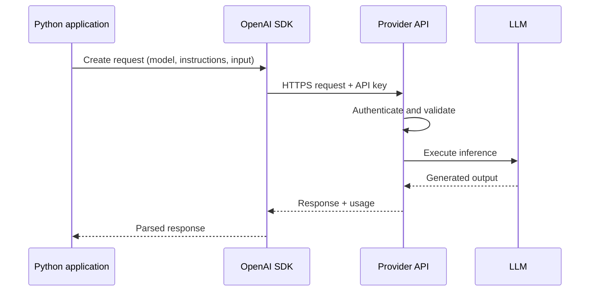
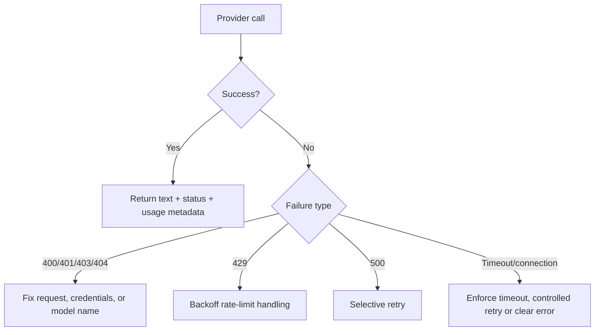
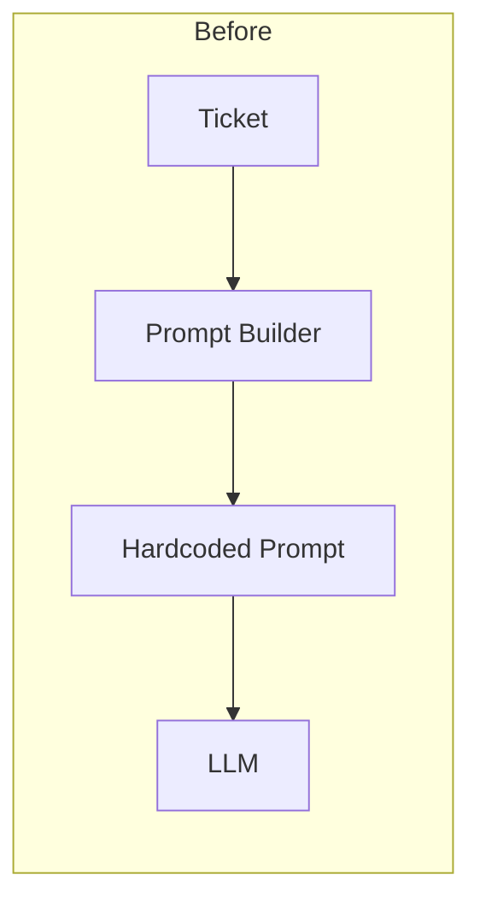
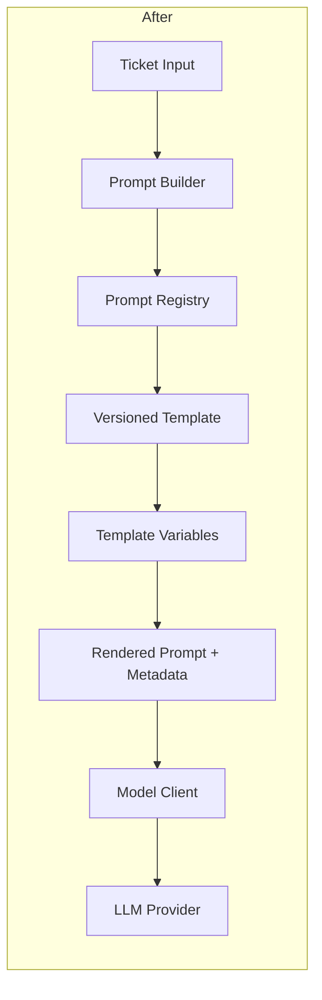
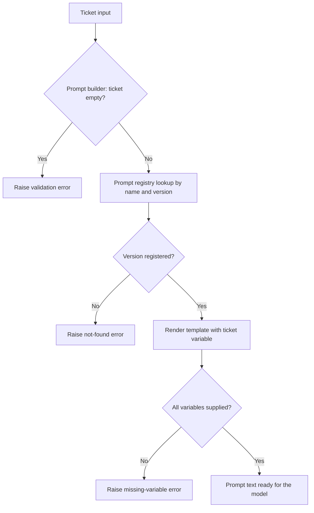
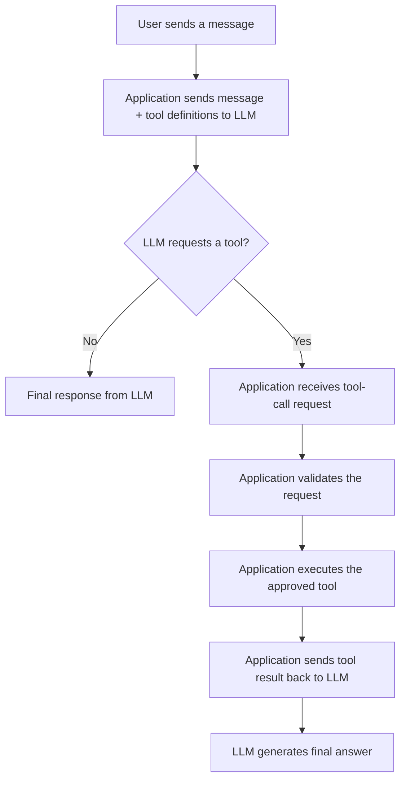
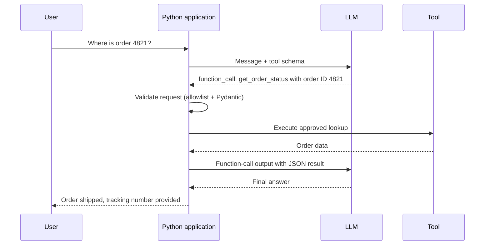

# Summaries — Stage 5: LLM Engineering

## Day 2 — LLM Provider APIs (Day 67)

Level: Intermediate · 2 hours
Topic: **LLM Provider APIs**

### Problem we are solving

After building a basic customer support assistant, the next question is what actually
happens when the application communicates with an LLM provider.

For a message such as "My order #4821 has not arrived", our application sends a request to
the provider. The provider authenticates the request, validates its parameters, selects the
requested model, executes inference, returns generated output, and supplies usage
information when available. Our engineering responsibility is to understand and control
that communication rather than treating it as a black box.

### Steps

1. **Understand the API architecture** — the Python application uses the OpenAI SDK as a
   client library to talk over HTTPS to the provider API, which runs inference on the model.
2. **Compare API interfaces** — review Chat Completions versus the Responses API and choose
   the Responses API as the preferred starting point for new integrations in this project.
3. **Inspect a request** — examine the model, instructions, and input parameters, plus
   optional sampling, output-length, tools, and streaming controls; compare outputs with
   general, customer-support, and restricted instruction styles.
4. **Inspect a response** — look beyond generated text at the response identifier, status,
   output items, convenient extracted text, model, and token usage metadata.
5. **Secure configuration** — keep API keys and the model identifier in environment
   variables or a secret manager, load them in a central settings module, and inject them
   into a provider adapter instead of hardcoding credentials.
6. **Handle provider failures** — set a request timeout, rely on SDK retries for transient
   failures where appropriate, translate connection and status errors into clear
   application-level errors, and map common HTTP codes to concrete remedial actions.
7. **Track usage and cost** — read input and output token counts from the response and use
   them with current per-million-token pricing to estimate inference cost.
8. **Build the provider integration** — split responsibilities between configuration, the
   provider adapter that communicates with the API, and the assistant that handles
   application-level behavior; accept a message, return text, track tokens, and handle
   errors.
9. **Test with mocks** — unit-test successful responses, authentication failures,
   connection failures, server errors, and usage extraction without requiring live API
   calls; run the test suite and the linter.
10. **Document and commit** — record the goal, problem, solution, concepts, trade-offs,
    code state, and next steps, then commit the integration.

### Notes

**Learning objectives:** understand how provider APIs work; distinguish Chat Completions
from the Responses API; build and inspect requests and responses; understand model
parameters; manage credentials securely; handle provider errors; track token usage; and
integrate the API into the project.

**API architecture:** the SDK is a client library that simplifies the provider's HTTP API.
The application creates a request, the SDK sends it with HTTPS and an API key, the provider
authenticates and validates it, the model executes inference and produces output, and the
provider returns a response with usage data that the SDK parses back into the application.

**Chat Completions vs Responses API:**

| Feature | Chat Completions | Responses API |
| --- | --- | --- |
| Main interface | `chat.completions.create()` | `responses.create()` |
| Message-based input | Yes | Yes |
| Text generation | Yes | Yes |
| Structured outputs | Supported | Supported |
| Tool calling | Supported | Supported |
| Multimodal capabilities | Supported | Supported |
| Recommended for new integrations | Existing interface | Preferred starting point |

The project uses the Responses API. Parameter support is not identical across all models,
so model-specific API references must be checked.

**Request parameters:**

| Parameter | Purpose |
| --- | --- |
| `model` | Selects the model |
| `instructions` | Defines model behavior |
| `input` | Provides the user input |
| `temperature` | Sampling control where supported |
| `max_output_tokens` | Limits generated output tokens |
| `tools` | Defines available tools |
| `stream` | Enables streaming where supported |

Changing `instructions` while keeping the same input is a useful experiment: a general
assistant, a polite customer-support assistant, and a restricted orders-only assistant
produce noticeably different answers.

**Response fields:**

| Field | Purpose |
| --- | --- |
| `id` | Response identifier |
| `status` | Response status |
| `output` | Generated output items |
| `output_text` | Convenient extracted text |
| `usage` | Token usage information |
| `model` | Model identifier |

Generated text is only part of the response. Status and metadata matter for monitoring and
production behavior, and usage matters for cost control.

**Authentication and configuration:** API keys must never be hardcoded in Python files.
Credentials belong in environment variables or a secret management system, loaded through
a settings module, with the model name configured the same way. A provider adapter owns API
communication and keeps provider details out of application logic.

**Error handling:**

| Status / failure | Possible cause | Engineering response |
| --- | --- | --- |
| 400 | Invalid request | Validate request parameters |
| 401 | Authentication failure | Check credentials |
| 403 | Insufficient permissions | Check access and project permissions |
| 404 | Invalid resource or model | Verify model identifier |
| 429 | Rate limit or quota issue | Apply appropriate backoff or investigate quota |
| 500 | Provider server error | Retry selectively |
| Timeout | Slow or unavailable provider | Enforce request timeout |

The SDK already retries certain transient failures; advanced retry policies are studied
later. Retrying indefinitely or ignoring rate limits is not acceptable.

**Token usage and inference cost:** every request consumes input tokens (instructions,
conversation history, user input) and output tokens (generated response); total tokens are
their sum. Cost is input tokens times input price per million, plus output tokens times
output price per million, divided by one million. Pricing varies by model and over time, so
current provider pricing must be consulted.

**Assignment responsibilities:** the settings module loads environment configuration, the
provider adapter handles API communication, and the assistant handles application-level
behavior. The expected behavior is to accept a message, send it to the Responses API,
return generated text with input and output token counts, handle provider errors, and keep
credentials out of source control. Tests must be mocked.

**Architecture decisions and trade-offs:**

| Decision | Choice | Trade-off |
| --- | --- | --- |
| API interface | Responses API | OpenAI-specific |
| SDK | Official Python SDK | Less low-level HTTP control |
| Configuration | Environment variables | Requires secret management |
| Timeout | 30 seconds | Limits long-running requests |
| Retry | SDK retries | Not all failures are retryable |
| Usage tracking | Provider metadata | Provider-specific response format |

**Assessment:** know which API the project uses, the role of a provider adapter, what input
tokens are, how to respond to HTTP 429, and where credentials belong. Definition of done
covers all of the above plus mocked provider tests, passing pytest and Ruff, documentation,
and a commit.

**Next direction:** Day 3 solves the architectural problem of talking to OpenAI, Ollama, or
another provider without changing business logic — provider abstraction, model client
interfaces, Python protocols and abstract classes, Pydantic request/response schemas,
dependency injection, multiple adapters, and provider-independent unit tests.

### Diagrams





## Day 5 — Prompt Templates and Versioning (Day 70)

Level: Intermediate · 2 hours
Topic: **Prompt Templates and Versioning**

### Problem we are solving

Prompts are written directly in Python strings. As the application grows there will be
multiple prompts, changing requirements, different use cases, and a need to know which
prompt version produced a given response.

The goal is to manage prompts like software: reusable, versioned, testable, and traceable.
Reusable templates keep instructions consistent while only the input data changes; version
identifiers make a particular prompt definition identifiable; a registry avoids scattering
prompt imports across the codebase; and tests catch prompt regressions without an API call.

### Steps

1. **Recognize the limitation of static prompts** — a hardcoded prompt must be edited or
   rebuilt for every new ticket, so separate the static instructions from the dynamic
   ticket value using a placeholder.
2. **Extend the prompts package** — add modules for the reusable template abstraction, the
   ticket classification prompts, the registry, and the prompt builder.
3. **Create the template abstraction** — use a frozen dataclass holding name, version,
   description, and template text, with a render method that injects named variables and
   converts a missing-variable error into a predictable application error.
4. **Create the first versioned prompt** — define ticket classification version 1.0.0 with
   categories, rules, and a ticket placeholder, using semantic versioning conventions.
5. **Build a prompt registry** — register templates under a name-and-version key, reject
   duplicate registrations and unknown lookups, and provide a factory that registers the
   available prompts.
6. **Render through the builder** — reject empty tickets, retrieve the requested prompt
   version from the registry, and render it with the ticket input.
7. **Try the rendered prompt** — verify that the classification instructions and the
   supplied ticket both appear in the final prompt text.
8. **Test prompts without an LLM** — cover template rendering, missing variables, metadata,
   registry retrieval of known and unknown prompts, builder content, and empty input; run
   the prompt test suite.
9. **Introduce a second version** — add version 2.0.0 with few-shot examples instead of
   overwriting version 1, register both versions, and use the registry to select or compare
   them for testing, deployment, and rollback.
10. **Review management choices and production needs** — compare prompt-management
    approaches, consider execution metadata and logging risks, document the work, and
    commit.

### Notes

**Learning objectives:** understand prompt templates and separation of static instructions
from dynamic variables; build a reusable template; implement versioning and metadata; test
prompts without calling a model; and track prompt changes with Git.

**Architecture shift:** before, a ticket went through a prompt builder into a hardcoded
prompt and then the LLM. After, the ticket flows through a prompt builder and a registry to
a versioned template; template variables produce rendered prompt text plus metadata, which
is sent through the model client to the provider. Reuse comes from changing variables, not
rewriting instructions; versioning makes the exact prompt definition identifiable.

**Static prompts vs templates:** a static prompt embeds the ticket in the string, so each
ticket requires manual rebuilding. A template keeps one instruction block with a placeholder
and renders it with different ticket values, so instructions stay consistent while data
changes.

**Template components:**

| Component | Purpose |
| --- | --- |
| Frozen dataclass | Reduces boilerplate and prevents metadata changes after creation |
| `name` | Identifies the prompt |
| `version` | Identifies the revision |
| `description` | Explains its purpose |
| `template` | Contains the prompt text |
| `render()` | Injects dynamic variables |
| Named variables | Accept inputs by placeholder name |
| Missing-variable handling | Detects missing values and raises a predictable error |

The initial implementation catches missing variables but does not reject unused variables or
validate the exact variable contract; that is a later improvement.

**Versioning conventions:** 1.0.0 marks an initial release, 1.1.0 a minor improvement such
as extra instructions or examples, and 1.1.1 a small correction. These are conventions, not
mandatory rules. Even minor wording changes can affect model behavior, so changes should be
measured, not assumed harmless.

**Registry:** the registry centralizes prompt lookup by name and version instead of requiring
every component to import a specific prompt definition. It rejects duplicate keys and
unknown prompts. A simple in-memory registry suits a small application; larger systems may
need a database, external prompt service, deployment configuration, or tenant-specific
selection.

**Rendering flow:** ticket input → prompt builder → prompt registry → retrieve version 1.0.0
→ render template → prompt text.

**Testing rationale:** prompts can break without any Python syntax error — a developer can
remove an instruction, rename a variable, or change a version. Automated tests protect the
rendered content, missing-variable behavior, metadata, registry lookups, and builder input
validation without any model call or network dependency.

**Second version:** version 2.0.0 adds few-shot examples for order status, refund, and
account tickets while keeping the original categories and rules. Keeping version 1 intact
allows side-by-side testing, deployment selection, and rollback.

**Management approaches:**

| Approach | Advantages | Trade-offs |
| --- | --- | --- |
| Hardcoded strings | Simple | Difficult to reuse and maintain |
| Python template | Simple, version-controlled | Requires code deployment |
| Jinja2 | Rich templating, conditionals, filters | Additional dependency and complexity |
| Database-based prompts | Dynamic management | Requires persistence and operational controls |
| External prompt platform | Collaboration, versioning, experimentation | Vendor dependency, cost, integration |

The current choice is Python templates plus Git: simple, but with proper prompt engineering
practices.

**Production considerations:** reproducible and auditable executions should record prompt
name, prompt version, prompt content or controlled template, model identifier, temperature,
sanitized input, model output, timestamp, evaluation score, and a trace ID. Raw prompts,
tickets, customer data, credentials, and other sensitive information must not be blindly
logged; retention follows data-handling policies. A prompt version alone is not enough to
reproduce an output — model version, generation settings, tools, context, and provider-side
changes also matter.

**Next direction:** Day 6 moves from free-form text to validated data structures with
Pydantic models, JSON schemas, constrained model outputs, and validation workflows.

### Diagrams







## Day 8 — Function Calling and Tool Schemas (Day 73)

Topic: **Function Calling and Tool Schemas**
Level: Intermediate · 2 hours
Repository: `ai-agent-py` (Python, OpenAI Responses API, Pydantic)

### Problem we are solving

The ticket-triage agent can classify a ticket and generate text, but it cannot access the
order database, check inventory, or perform application operations on its own.

For the message "My order #4821 has not arrived", classification produces an order ID and a
flag saying an order lookup is needed. That tells the application *that* it should look up
the order, but not *how* to retrieve the real order status. A controlled tool is needed.

The core insight: the LLM never executes Python functions directly. It produces a structured
tool-call request. The application validates that request, decides whether execution is
allowed, runs the corresponding function, and returns the result to the model. The model
then writes the final answer using only the returned data, so it cannot invent an order
status.

This matters for reliability (deterministic data retrieval instead of hallucination),
control (the application, not the model, authorizes actions), and security (tool access can
be allowed, restricted, audited, and approved according to risk).

### Steps

1. **Recognize the gap** — classification alone cannot retrieve real order data; define a
   specific `get_order_status`-style tool that the application owns.
2. **Create the tool directory and implementation** — add a tools package with a mock order
   database and a deterministic function that returns either a found record with its status
   and tracking number, or a not-found result.
3. **Define the tool schema** — describe the function as a function tool with a name, a
   purpose description, an object-shaped parameters schema, typed properties, a required
   argument list, no additional properties, and strict mode where supported.
4. **Create the tool executor** — build an allowlist mapping tool names to Python functions;
   reject unknown names, parse the JSON arguments, ensure they form an object, call the
   approved function, and serialize the result back to JSON text.
5. **Connect the schema to the Responses API** — send the user message together with the
   tool definition to the model and inspect the output for function-call requests.
6. **Implement the tool-calling loop** — when a call is requested, execute it through the
   executor, package the JSON result as a function-call output linked to the call ID, send
   it back to the model, and repeat until the model returns a final text answer.
7. **Add local argument validation** — define a strict Pydantic argument model that forbids
   extra fields, validate the parsed arguments in the executor before calling the tool, and
   pass only the validated value to the function.
8. **Test the tools independently of the LLM** — unit-test the order lookup for found and
   not-found cases, test successful executor dispatch, rejection of unsupported tools, and
   rejection of unexpected arguments; run the tools test suite.
9. **Review security and document the work** — apply the risk and permission guidance,
   record the day's component, goal, trade-offs, and next steps in the development log, and
   commit the tool integration.

### Notes

#### Tool calling

Tool calling is a mechanism through which a model requests that an application execute an
external function or tool. The model decides when to request a tool based on its
instructions, the available tool definitions, and the conversation context. The application
decides whether to execute that request. Typical examples include order lookup, customer
search, refund workflows, knowledge-base search, weather lookup, and deterministic
calculation.

#### Tool schemas

The schema is a contract telling the model the tool's name, what it does, what arguments it
accepts, their types, and which are required.

| Component | Purpose |
| --- | --- |
| `type` | Declares a function tool |
| `name` | Tool identifier |
| `description` | Helps the model understand when to use the tool |
| `parameters` | Defines the argument schema |
| `properties` | Defines available arguments |
| `required` | Specifies mandatory arguments |
| `additionalProperties` | Prevents extra arguments |
| `strict` | Enables strict structured tool arguments where supported |

A clear description is important because the model uses it to decide whether and how to
request the tool. Good design means one clear responsibility per tool, specific names,
typed and minimal arguments, restricted inputs, no internal implementation details, and no
sensitive operations exposed without authorization. A broad "do everything" tool is
ambiguous and hard to secure; a narrow lookup tool is easy to test, authorize, audit, and
maintain.

#### Tool implementation and executor

The learning tool uses a small mock order database with shipped, processing, and delivered
orders. Given the same database state and ID it always returns the same record; the model
has no access to that data source.

The executor is the application's control point. Its allowlist prevents arbitrary function
execution, JSON parsing turns the model's argument text into data, the validated arguments
are passed to the approved function, and JSON serialization turns the result into tool
output for the next model call. The early learning version did not validate schemas locally,
check authorization, or constrain argument values — those were added next.

#### Tool-calling lifecycle

1. The user sends a message.
2. The application sends the message and tool definitions to the LLM.
3. The LLM requests a tool.
4. The application receives and validates the request.
5. The application executes the approved tool.
6. The application sends the tool result back to the LLM.
7. The LLM generates the final answer.

A request is only data produced by the model; execution is an application decision. In the
concrete example, the user asks where order 4821 is, the model requests a lookup with the
order ID, the application runs the function, the tool returns the shipped status and
tracking number, and the model turns that into the final response.

#### Local validation

The provider's tool schema is not the security boundary. Requests can be malformed,
arguments can violate domain rules, the model can be influenced by prompt injection,
application permissions may restrict execution, and tools may have business constraints. A
strict Pydantic argument model with extra fields forbidden rejects unexpected input before
any tool runs. The boundary is: LLM tool request → application validation → authorization →
tool execution → controlled result.

#### Testing notes

Tests cover the tool directly (found and not-found orders) and the executor (successful
dispatch, unsupported tool, extra argument). Broad exception assertions are acceptable in a
learning experiment; production tests should assert exact types such as validation errors or
JSON decoding errors.

#### Security fundamentals

Tool calling introduces action risk: a model request is not evidence that the operation is
safe.

| Risk | Mitigation |
| --- | --- |
| Unauthorized data access | Enforce authorization in the application |
| Prompt injection | Treat user content and retrieved content as untrusted |
| Arbitrary tool execution | Use an explicit tool allowlist |
| Invalid arguments | Validate with Pydantic |
| Excessive tool calls | Add limits |
| Sensitive data leakage | Restrict tool outputs |
| Destructive operations | Require explicit approval |
| Tool abuse | Audit and monitor execution |
| SQL injection | Use parameterized queries |
| API abuse | Rate limits and quotas |

Tools should have different permission levels: a low-risk order lookup usually needs no
extra approval, customer search needs authorization, refund workflows depend on policy and
approval, issuing refunds needs explicit controls, and deleting customers needs strict
approval. The model can recommend an action but cannot grant itself permission.

#### Known limitations and next direction

The minimal loop does not preserve full prior conversation context across API calls, enforce
tool-call limits, handle errors, validate arguments locally, or handle authorization —
validation was addressed in this lesson, while the rest is deferred. The next stage replaces
the single-tool experiment with a reusable orchestration engine: multiple tools, dispatching,
turn and call limits, control flow, tool result handling, and an agent loop, followed by
conversation state, memory, and context management.

### Diagrams

#### Architecture

```text
User Message
    |
    v
   LLM ---- Tool Call? ----> No --> Final Response
    |
   Yes
    v
Tool Request --> Application Validation --> Tool Executor --> Tool Result --> LLM --> Final Response
```

#### Tool-calling lifecycle



#### Tool-calling loop


