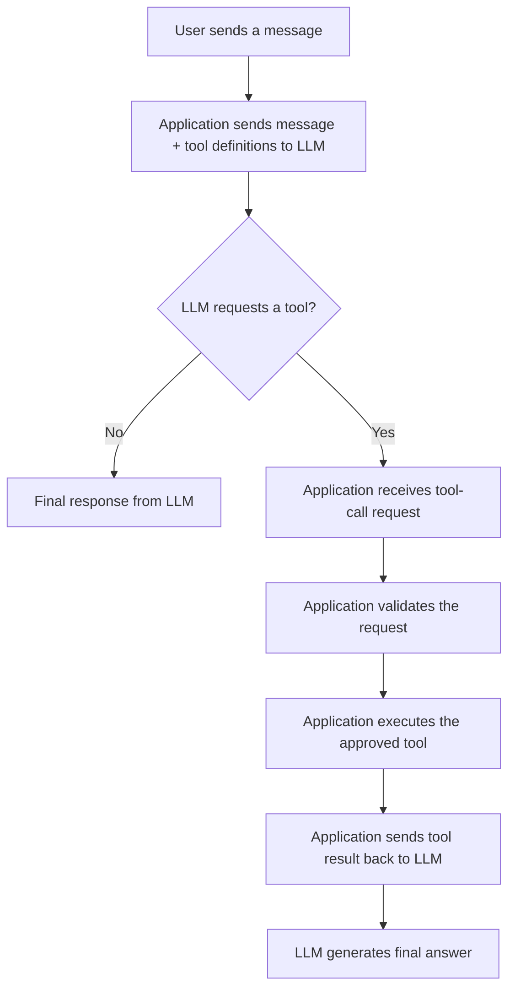
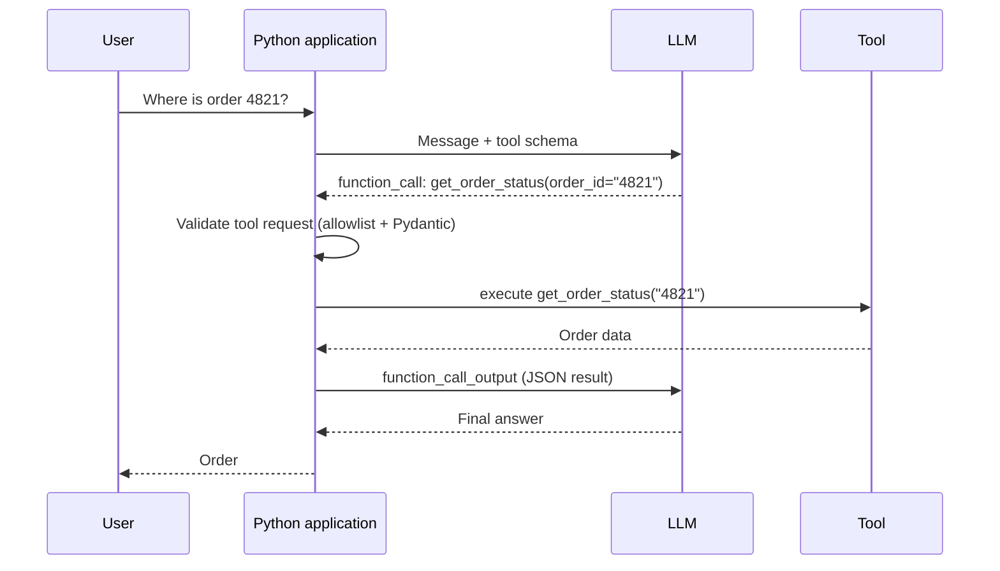

# Summary — Stage 5: LLM Engineering, Day 8 (Day 73)

Topic: **Function Calling and Tool Schemas**
Level: Intermediate · 2 hours
Repository: `ai-agent-py` (Python, `uv`, OpenAI Responses API, Pydantic)

## 1. Problem we are solving

The ticket-triage agent can classify a ticket and generate text, but it has no way to
access real application data or perform application operations.

Example input:

```text
My order #4821 has not arrived.
```

Current classification:

```json
{
  "category": "order_status",
  "order_id": "4821",
  "needs_order_lookup": true
}
```

The classification tells the application an order lookup is needed, but not how to
retrieve the order. The missing piece is a **tool**:

```python
def get_order_status(order_id: str) -> dict:
    ...
```

Key insight: **the LLM does not execute Python functions directly.** It emits a structured
tool-call request; the application validates the request, decides whether execution is
allowed, executes the function, and returns the result to the model. The model then writes
the final answer using only that returned data. This prevents the model from inventing
order status information.

## 2. Learning objectives

- Understand what tool calling is and why the LLM cannot call Python functions itself.
- Understand the tool-calling lifecycle.
- Understand tool schemas and JSON Schema.
- Expose tools to the LLM and detect tool-call requests.
- Define a clear tool interface.
- Separate an LLM's *request* for an action from the application's *execution* of it.
- Apply tool-calling security fundamentals.

## 3. What is tool calling?

Tool calling is a mechanism through which a model requests that an application execute an
external function or tool. The model decides *when* to request a tool based on instructions,
available tool definitions, and conversation context. The application decides *whether* to
execute the request.

| Tool | Purpose |
| --- | --- |
| `get_order_status` | Retrieve an order |
| `search_customer` | Retrieve customer information |
| `create_refund_request` | Initiate a refund workflow |
| `search_knowledge_base` | Retrieve documentation |
| `get_weather` | Retrieve weather information |
| `calculate_total` | Perform deterministic calculations |

## 4. Diagrams

### 4.1 Architecture (as introduced in the lesson)

```text
User Message
    |
    v
   LLM ---- Tool Call? ----> No --> Final Response
    |
   Yes
    v
Tool Request --> Application Validation --> Tool Executor --> Tool Result --> LLM --> Final Response
```

### 4.2 Tool-calling lifecycle



### 4.3 Tool-calling loop (sequence)



The lesson notes this minimal experiment **does not yet** preserve full prior conversation
context between API calls, enforce a tool-call limit, handle errors, validate arguments
locally, or handle authorization. Those are intentionally deferred to Day 9.

## 5. Notes

### 5.1 Tool schema — the contract

The model needs the tool name, purpose, accepted arguments, argument types, and required
arguments. This is described with a function tool schema (JSON Schema for `parameters`):

```json
{
  "type": "function",
  "name": "get_order_status",
  "description": "Retrieve the current status of a customer order.",
  "parameters": {
    "type": "object",
    "properties": {
      "order_id": {
        "type": "string",
        "description": "The customer's order identifier."
      }
    },
    "required": ["order_id"],
    "additionalProperties": false
  },
  "strict": true
}
```

| Component | Purpose |
| --- | --- |
| `type` | Declares a function tool |
| `name` | Tool identifier |
| `description` | Helps the model decide when to use the tool |
| `parameters` | Defines the argument schema |
| `properties` | Defines available arguments |
| `required` | Specifies mandatory arguments |
| `additionalProperties` | Prevents extra arguments |
| `strict` | Enables strict structured tool arguments where supported |

A good description matters: the model uses it to decide whether and how to request the tool.

Design principles:

- **Good:** one clear responsibility, specific names, descriptive docs, typed/minimal
  arguments, restricted inputs, no internal implementation details, no unauthenticated
  sensitive operations.
- **Bad:** a broad `do_everything(action, customer, order, refund, database)` tool —
  ambiguous, hard to test, hard to secure. Specific tools (`get_order_status(order_id)`)
  are easier to test, authorize, audit, and maintain.

### 5.2 The tool (mock order database)

Implemented in `src/ai_agent/tools/order_tools.py`: a small `ORDERS` dict keyed by order ID
(`4821` shipped / `TRK-10001`, `4822` processing / no tracking, `4823` delivered /
`TRK-10003`) and `get_order_status(order_id: str) -> dict` returning either
`{"found": True, "order": {...}}` or `{"found": False, "order_id": ...}`.

The tool is deterministic: for the same database state and order ID it returns the same
record. The LLM has no access to the mock DB; only the Python application does.

### 5.3 Tool executor (allowlist + dispatch)

`src/ai_agent/tools/tool_executor.py` maps tool names to Python functions and returns JSON
text:

```python
def execute_tool(tool_name: str, arguments: str) -> str:
    if tool_name not in TOOL_MAP:          # or `!= "get_order_status"` in the final version
        raise ValueError(f"Unsupported tool: {tool_name}")
    parsed_arguments = json.loads(arguments)
    if not isinstance(parsed_arguments, dict):
        raise ValueError("Tool arguments must be a JSON object.")
    tool = TOOL_MAP[tool_name]
    return json.dumps(tool(**parsed_arguments))
```

| Component | Responsibility |
| --- | --- |
| `TOOL_MAP` | Allowlist of executable tools |
| `tool_name` | Name requested by the LLM |
| `json.loads()` | Parses the arguments |
| Allowlist lookup | Prevents arbitrary function execution |
| `tool(**parsed_arguments)` | Executes the approved tool |
| `json.dumps()` | Converts the result into JSON text |

Initial limitation: no local schema validation, authorization, or protection against
arbitrary argument values.

### 5.4 Responses API integration

`experiments/tool_calling.py` creates an `OpenAI` client (`timeout=30.0`, `max_retries=2`),
passes `tools=[GET_ORDER_STATUS_TOOL]` to `client.responses.create(...)`, then loops:

1. Inspect `response.output` for items with `type == "function_call"`.
2. If none exist, return `response.output_text`.
3. For each call, run `execute_tool(tool_call.name, tool_call.arguments)`.
4. Append `{"type": "function_call_output", "call_id": ..., "output": result}`.
5. Send those outputs back to the model with a shorter "use tool results, do not invent"
   instruction and continue the loop.

Instructions emphasize: never invent order status, use the tool when an ID is available,
use only tool-returned information, explain when an order is not found, and never claim a
tool ran if it did not.

### 5.5 Local argument validation with Pydantic

`src/ai_agent/tools/schemas.py`:

```python
class GetOrderStatusArguments(BaseModel):
    model_config = ConfigDict(extra="forbid", strict=True)
    order_id: str
```

The executor parses the LLM's JSON string, calls
`GetOrderStatusArguments.model_validate(parsed_arguments)`, then calls
`get_order_status(order_id=validated_arguments.order_id)`. `extra="forbid"` rejects
unexpected keys; `strict=True` prevents coercion.

**Why validate locally?** The provider's tool schema is not the security boundary. Requests
can be malformed, arguments can violate domain rules, the model can be compromised by prompt
injection, application permissions may restrict execution, and tools may have business
constraints.

```text
LLM Tool Request -> Application Validation -> Authorization -> Tool Execution -> Controlled Result
```

### 5.6 Tests

- `tests/tools/test_order_tools.py`: order exists / order not found.
- `tests/tools/test_tool_executor.py`: successful execution, unsupported tool raises
  `ValueError`, extra argument is rejected.

Command:

```bash
uv run pytest tests/tools/ -v
```

The broad `Exception` assertions in the lesson are for brevity; production tests should
assert exact types such as `ValidationError` or `JSONDecodeError`.

### 5.7 Security fundamentals

Tool calling introduces **action risk**: a model request is not proof the operation is safe.

| Risk | Mitigation |
| --- | --- |
| Unauthorized data access | Enforce authorization in the application |
| Prompt injection | Treat user content and retrieved content as untrusted |
| Arbitrary tool execution | Use an explicit tool allowlist |
| Invalid arguments | Validate with Pydantic |
| Excessive tool calls | Add limits |
| Sensitive data leakage | Restrict tool outputs |
| Destructive operations | Require explicit approval |
| Tool abuse | Audit and monitor execution |
| SQL injection | Use parameterized queries |
| API abuse | Rate limits and quotas |

Tool permission levels:

| Tool | Risk | Approval |
| --- | --- | --- |
| `get_order_status` | Low to moderate | Usually none |
| `search_customer` | Moderate | Authorization required |
| `create_refund_request` | High | Policy/approval dependent |
| `issue_refund` | High | Explicit authorization and controls |
| `delete_customer` | Critical | Strict approval and controls |

The model can recommend an action; it cannot grant itself permissions. Authorization belongs
to the application.

### 5.8 Project structure for this lesson

```text
ai-agent-py/
├── src/ai_agent/
│   ├── application/
│   ├── domain/
│   ├── providers/
│   ├── prompts/
│   └── tools/
│       ├── __init__.py
│       ├── order_tools.py
│       ├── tool_schemas.py
│       ├── tool_executor.py
│       └── schemas.py
├── experiments/
│   └── tool_calling.py
├── tests/
│   └── tools/
│       ├── test_order_tools.py
│       └── test_tool_executor.py
├── LOG.md
└── pyproject.toml
```

Lesson workflow: implement tool → write schema → add executor/allowlist → integrate
Responses API → add Pydantic validation → write tests → update `LOG.md` → commit:

```bash
git add src/ai_agent/tools experiments/tool_calling.py tests/tools LOG.md
git commit -m "feat: introduce LLM tool calling and execution"
```

In the current repository this corresponds to commit `6851b0d`. Later commits (`c7ff34b`,
`28e69da`) already add Day 9's reusable orchestration (`ToolRegistry`, `ToolDispatcher`,
`ToolResult`, `AgentOrchestrator`, turn/call limits, multiple tools), so the tool files now
contain more than the single-tool lesson version.

### 5.9 Completion checklist (all covered by the lesson)

Tool calling understood · tool schemas understood · lifecycle understood ·
`get_order_status` created · schema defined · allowlist created · executor implemented ·
Pydantic validation added · Responses API integrated · loop implemented · execution tested ·
security fundamentals covered · `LOG.md` updated · changes committed.

## 6. Quiz prompts (review without peeking)

1. What is tool calling?
2. Does the LLM execute Python functions directly?
3. What is a tool schema?
4. Why do we use a tool allowlist?
5. Why should tool arguments be validated locally?
6. What is the difference between a tool request and tool execution?
7. Why should a refund tool have stronger controls than an order lookup tool?
8. How does the tool result get returned to the LLM?
9. What is prompt injection, and why is it relevant to tools?
10. What happens if the LLM requests an unsupported tool?

Short answers: (1) model requests an app-executed function; (2) no — it emits a structured
request; (3) a JSON Schema contract describing name, purpose and arguments; (4) arbitrary
functions must never be reachable by name from model output; (5) the schema sent to the model
is not a security boundary and domain rules still apply; (6) request is data from the model,
execution is an application decision; (7) refunds are destructive/high-risk and need
authorization; (8) as a `function_call_output` message in the next API call; (9) untrusted
text that can manipulate the model into requesting harmful tools, so validate/authorize;
(10) the executor rejects it (e.g. `ValueError: Unsupported tool`).

## 7. Next

Day 9 / Day 74 — **Tool Execution and Orchestration**: a reusable orchestration layer with
multiple tools, dispatching, execution limits (turns and tool calls), control flow, tool
result handling, and a reusable agent loop instead of a one-off experiment. Following topics
include conversation state, memory, and context management.
