# Component Diagram

Status: Target design with current gap annotations · 2026-11-24

## Purpose

This view shows the internal modules, their responsibilities, and the dependency rules that make
provider substitution, testing, and evaluation possible. The diagram is the **target**; the tables
identify what is already present and what is still wrong.

```mermaid
flowchart TB
    subgraph Entry[Entry layer]
        Main[main.py<br/>composition root]
    end

    subgraph Application[Application layer]
        Assistant[CustomerSupportAssistant]
        Orchestrator[AgentOrchestrator]
        Classifier[Ticket classifier]
        ParseValidate[Parser and validator]
        RetryErrors[Retry and error taxonomy]
        ConvManager[Conversation manager]
        ContextManager[Context manager]
        MemoryManager[Memory manager]
        ModelClient[ModelClient port]
        GenConfig[Generation config and options]
        ModelSelection[Model registry and selector]
        StorePort[Conversation store interface]
    end

    subgraph Domain[Domain layer]
        Models[Model request and response]
        Ticket[TicketClassification]
        Conversation[Conversation and Message]
        Memory[MemoryFact and LongTermMemory]
        ModelDef[ModelDefinition]
    end

    subgraph Prompts[Prompt layer]
        Template[PromptTemplate]
        Registry[PromptRegistry]
        Builder[PromptBuilder]
    end

    subgraph Providers[Provider adapters]
        OpenAIProvider[OpenAIProvider]
        OllamaProvider[OllamaProvider]
        Factory[Provider factory target]
    end

    subgraph Tools[Tool layer]
        ToolRegistry[ToolRegistry]
        Dispatcher[ToolDispatcher]
        Schemas[Strict argument schemas]
        Handlers[Order, customer, FAQ handlers]
        Approval[Approval gate target]
    end

    subgraph Infrastructure[Configuration and persistence]
        Settings[Settings]
        Profiles[Generation profiles]
        Catalog[Model catalog]
        SQLiteStore[ConversationStore]
    end

    Main --> Assistant
    Main --> Orchestrator
    Assistant --> ModelClient
    Orchestrator --> ModelClient
    Orchestrator --> ToolRegistry
    Orchestrator --> ParseValidate
    Orchestrator --> RetryErrors
    Classifier --> Builder
    Classifier --> ModelClient
    Classifier --> ParseValidate
    Classifier --> RetryErrors
    ConvManager --> ContextManager
    ConvManager --> StorePort
    MemoryManager --> StorePort
    MemoryManager --> Memory
    ContextManager --> Conversation
    ParseValidate --> Ticket
    ModelSelection --> ModelDef
    GenConfig --> ModelSelection
    Factory --> ModelClient
    OpenAIProvider -.implements.-> ModelClient
    OllamaProvider -.implements.-> ModelClient
    ToolRegistry --> Schemas
    ToolRegistry --> Handlers
    Dispatcher --> ToolRegistry
    Dispatcher --> Approval
    Settings --> Factory
    Profiles --> GenConfig
    Catalog --> ModelSelection
    SQLiteStore -.implements.-> StorePort
```

## Component responsibilities

| Layer | Component | File | Current status |
| --- | --- | --- | --- |
| Entry | Composition root / CLI | `src/ai_agent/main.py` | Observed; constructs OpenAI directly and hardcodes input |
| Application | `CustomerSupportAssistant` | `src/ai_agent/application/assistant.py` | Observed; uses `ModelRequest`/`ModelResponse` |
| Application | `Assistant` | `src/ai_agent/application/assistant.py` | Observed; uses string `ModelClient` and streaming |
| Application | `AgentOrchestrator` | `src/ai_agent/application/orchestrator.py` | Observed; creates `OpenAI`, reads env, builds registry |
| Application | Ticket classifier | `src/ai_agent/application/ticket_classifier.py` | Observed; creates `OpenAI`, reads env |
| Application | Parser / validator | `src/ai_agent/application/response_parser.py`, `ticket_validation.py` | Observed; validator import is broken |
| Application | Retry / errors | `src/ai_agent/application/retry.py`, `errors.py` | Observed; inconsistent error taxonomy |
| Application | Conversation manager / context | `src/ai_agent/application/conversation_manager.py`, `context_manager.py` | Observed; not wired to orchestrator |
| Application | Memory manager and services | `src/ai_agent/application/memory_*.py` | Observed; not wired to context/orchestrator |
| Application | Model contract | `src/ai_agent/application/model_client.py` | Observed; conflicts with `domain/models.py` |
| Application | Generation config / selection | `src/ai_agent/application/generation_*.py`, `model_*.py` | Observed; not wired to providers |
| Domain | Request/response, ticket, conversation, memory, model definition | `src/ai_agent/domain/**` | Observed |
| Prompts | Templates, registry, builder | `src/ai_agent/prompts/**` | Observed; builder pinned to ticket prompt v1 |
| Providers | OpenAI adapter | `src/ai_agent/providers/openai_provider.py` | Partial; `stream()` broken |
| Providers | Ollama adapter | `src/ai_agent/providers/ollama_provider.py` | Written but not importable |
| Providers | Provider factory | Target | Not implemented |
| Tools | Registry / dispatcher / schemas / handlers | `src/ai_agent/tools/**` | Observed; `tool_executor.py` is an older path |
| Tools | Approval gate | Target | Not implemented |
| Config | Settings | `src/ai_agent/config.py` | Observed; import-time failure on missing env |
| Config | Profiles / catalog | `src/ai_agent/config/**` | Written but unimportable due to module/package conflict |
| Persistence | `ConversationStore` | `src/ai_agent/application/conversation_store.py` | Observed; SQLite, owner-scoped facts |

## Dependency rules

1. **Entry layer** composes dependencies and may import any layer.
2. **Application layer** may import domain, ports, prompts, and tool interfaces. It must not import
   provider SDKs, `os.environ` for model choice, or storage SQL.
3. **Domain layer** imports only language/Pydantic primitives. It must not import OpenAI, Ollama,
   FastAPI, SQLite, or application services.
4. **Prompt layer** depends on domain types, not providers.
5. **Provider adapters** implement the canonical model port and own SDK/HTTP event translation,
   generation-option mapping, and error normalization.
6. **Tool layer** exposes schemas and a dispatcher; handlers own data access. Application code
   enforces allowlists, validation, authorization, and approval.
7. **Configuration and persistence** are infrastructure details injected through interfaces.

## Current violations

| Violation | Location | Target correction |
| --- | --- | --- |
| SDK client constructed in application | `orchestrator.py:3,26-29`; `ticket_classifier.py:3,21-24` | Inject provider through `ModelClient` |
| Model read from environment in application | `orchestrator.py:43,113`; `ticket_classifier.py:35` | Resolve model in provider/factory/config |
| Prompts embedded in orchestrator | `orchestrator.py:44-55,114-121` | Use prompt registry/builder |
| Registry built inside orchestrator | `orchestrator.py:31-33` | Inject registry/dispatcher from composition root |
| Two incompatible model contracts | `model_client.py:5-8` vs. `domain/models.py` | Choose one (`Q-12`) and migrate all callers |
| `config.py` shadows `config/` | `src/ai_agent/config.py`, `src/ai_agent/config/` | Convert to a package with explicit settings module |
| Import of undefined `LLMValidationError` | `ticket_validation.py:1-4` | Extend error taxonomy and add validation tests |
| Undefined `Iterator` / `self.model` in stream | `openai_provider.py:48-53` | Implement adapter stream correctly |
| Ollama package not declared | `providers/ollama_provider.py`, `pyproject.toml` | Add dependency and mocked tests |
| Broad exception handling in tool loop | `orchestrator.py:90` | Use classified errors with sanitized messages |

## Refactoring sequence

1. Decide and document the canonical model contract (`ADR-004` / `Q-12`).
2. Fix configuration packaging so profiles and catalog import cleanly.
3. Repair streaming and validation import errors to restore green tests/lint.
4. Introduce the provider factory and inject one provider into CLI and orchestrator.
5. Move prompt text into the prompt registry and inject the builder.
6. Inject registry, dispatcher, store, conversation, and memory collaborators.
7. Add approval, authorization, and observability at the application boundary.
8. Wire the end-to-end flow and run the evaluation harness.

## Traceability

Supports `FR-02`, `FR-03`, `FR-04`, `FR-05`, `FR-06`, `FR-08`, `FR-10`, `FR-11`, `FR-12`,
`FR-14`, `FR-15`, `NFR-09`, `NFR-10`, `NFR-12`, and `ADR-001`, `ADR-002`, `ADR-003`.
