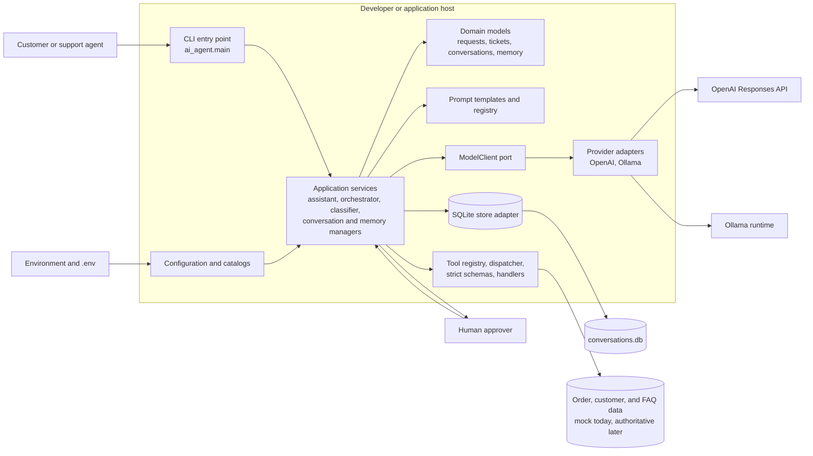

# Container Diagram

Status: Current and target · 2026-11-24

## Purpose

This view identifies the runtime/deployable units and the major external stores and systems. In
this phase, **all application containers run in one Python process**: the chosen shape is a
modular monolith (`ADR-001`).

## Containers

| Container | Responsibility | Technology | Current state |
| --- | --- | --- | --- |
| CLI entry point | Configure the composition root, accept input, render output/errors | Python `main()` | Observed; hardcoded message |
| Application services | Coordinate answering, classification, tools, conversation, memory, retries | Python classes/functions | Observed; partially unwired |
| Domain models | Shared request, response, ticket, conversation, memory, model definitions | Python dataclasses / Pydantic | Observed |
| Prompts | Versioned templates, registry, builder | Python | Observed |
| Model port | Provider-neutral generation/streaming contract | `typing.Protocol` | Observed but conflicting contract |
| Provider adapters | Translate requests/events/errors to OpenAI or Ollama APIs | OpenAI SDK; `ollama` client | OpenAI partial; Ollama dependency missing |
| Tool containers | Allowlist, strict arguments, dispatch, handlers | Python + Pydantic | Observed with in-memory data |
| Configuration | Load settings, task profiles, model catalog | `python-dotenv`; Python modules | Settings observed; profiles/catalog unimportable |
| Store adapter | Persist conversations, messages, summaries, owner-scoped facts | SQLite | Observed; not integrated with orchestrator |
| SQLite database | Durable state for the process | File `conversations.db` | Observed |
| Environment | Secrets and model/provider selection | `.env` / process env | Observed; missing values fail at import |
| Approval gate | Record human decision before consequential action | Target application control | Planned |

## Communication paths

| From → To | Mechanism | Notes |
| --- | --- | --- |
| CLI → application | In-process Python calls | Composition root should inject dependencies |
| Application → domain | In-process immutable models/views | Domain must not import infrastructure |
| Application → prompts | In-process builder/registry calls | Prompt version is explicit |
| Application → model port | In-process `generate()` / `stream()` | Canonical contract pending (`Q-12`) |
| Model port → provider | Adapter implementation | Provider selection via factory target |
| Provider → OpenAI / Ollama | SDK / HTTP | Timeouts, retries, error normalization at adapter |
| Application → tools | In-process dispatcher | Allowlist + schema validation before handler |
| Tools → data | Handler call | Mock today; authorized integration later |
| Application → store adapter | In-process repository calls | Owner-scoped queries; parameterized SQL |
| Store adapter → SQLite | File I/O | Single-writer file; no migration layer yet |
| Environment → configuration | `load_dotenv()` at startup | Validate once; clear startup errors target |
| Application → approver | Application gate / UI adapter target | Blocks consequential tool execution |

## Deployment view

### Current

- One local CLI process launched with `uv run ai-agent-py`.
- One SQLite file in the working directory.
- OpenAI SDK network egress; provider and model from environment.
- No HTTP server, containers, queue, worker pool, or deployment pipeline.
- Tests and Ruff run locally; CI is not configured.

### Target

- One deployable modular-monolith application with a thin CLI or transport adapter.
- Same process hosts orchestration, classification, conversation, memory, prompts, and tools.
- Approved providers remain external; local Ollama remains optional and restricted.
- Durable state moves behind a repository interface; SQLite may remain for development.
- CI runs tests, lint, evaluation, and security checks before release.

## Boundaries and ownership

- **Process boundary:** everything inside `src/ai_agent/` is application code; SDKs, databases,
  environment, and runtime APIs are external.
- **Ownership boundary:** each conversation, message, and fact is scoped to an owner; `owner_id`
  must come from authenticated context before production.
- **Authority boundary:** order status, permissions, and workflow state come from tools or
  application code, never from model output or memory.
- **Control boundary:** consequential actions stop at the approval gate.
- **Configuration boundary:** provider/model IDs and generation profiles are configuration, not
  hard-coded application logic.

## Operational implications

- A single process simplifies transactions and debugging but shares failure domains.
- SQLite is adequate for development/prototype persistence; concurrency and managed operations
  require a later decision.
- Provider latency and failure rates dominate the response path; timeouts, retries, and fallback
  belong at the adapter/factory boundary.
- Tool handlers execute in-process today, so authorization and input validation are mandatory
  before they can call real systems.

## Traceability

Supports `FR-01`, `FR-04`, `FR-10`, `FR-11`, `FR-14`, `FR-15`, `NFR-09`, `NFR-11`, `NFR-13`,
and `ADR-001`.
