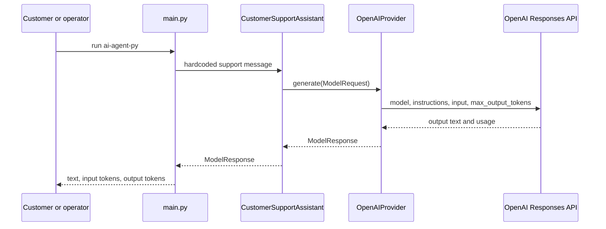
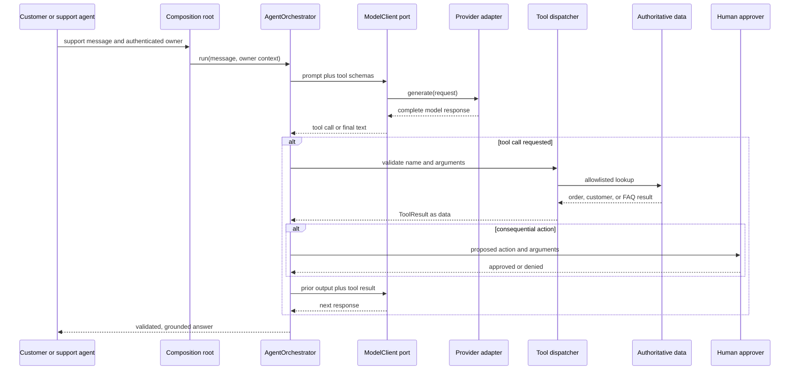
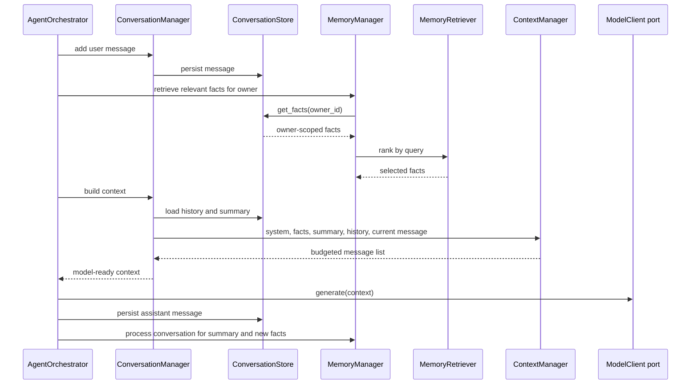
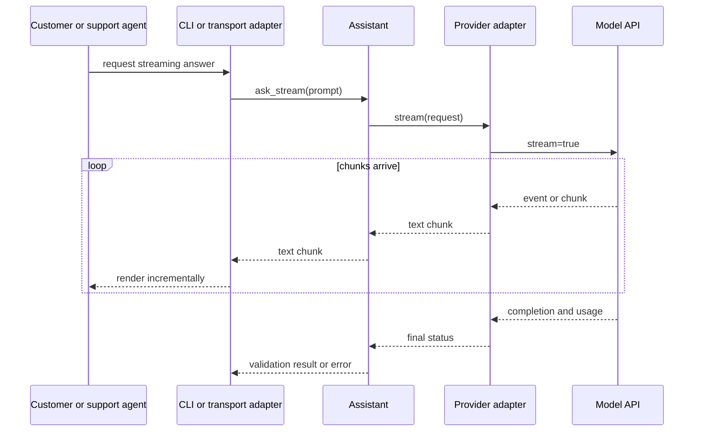

# Data Flow

Status: Current and target · 2026-11-24

## Purpose

This view traces how data moves through the system, where it is stored, and where trust changes.
It distinguishes the current one-shot path from the target tool-grounded, multi-turn path.

## Current one-shot flow

Observed in `src/ai_agent/main.py:5-16`, `src/ai_agent/application/assistant.py:9-19`, and
`src/ai_agent/providers/openai_provider.py:16-46`. Classification, tools, conversation, memory,
and streaming are not part of this path.

## Target tool-grounded flow

The orchestrator currently implements a 5-turn / 10-tool-call version of this loop but still
constructs the provider, reads `OPENAI_MODEL`, and embeds prompt instructions
(`src/ai_agent/application/orchestrator.py:20-126`). Tool results are already labeled as data, not
instructions (`orchestrator.py:50-55, 118-120`). The approval gate is not implemented.

## Target conversation and memory flow

Target context order: **system instructions → relevant long-term facts → conversation summary →
recent history → current request**. The current `ContextManager` supports system prompt, memory
summary/facts, bounded history, and current message, but does not yet accept retrieved long-term
facts separately or trigger automatic summarization
(`src/ai_agent/application/context_manager.py:35-124`; `README.md:120-123`). `MemoryManager`
already coordinates summarize, extract, save, and retrieve with owner scoping
(`src/ai_agent/application/memory_manager.py:21-47`).

## Target streaming flow

Provider-specific event iteration belongs in the adapter. A complete response is collected and
validated before any structured use; partial streamed JSON is never a classification result. The
`Assistant.ask_stream()` relay exists (`assistant.py:32-33`), but the OpenAI provider stream method
is incomplete (`openai_provider.py:48-53`).

## Data classification

| Data | Classification | Handling rule |
| --- | --- | --- |
| Support message | Untrusted input | Validate size/emptiness; treat content as data |
| `owner_id` | Sensitive identity | Derive from authenticated context; scope all queries |
| Model instructions/prompt | Controlled configuration | Version in prompt registry; review changes |
| Model output | Untrusted result | Check status, refusal, completion, schema, business rules |
| Tool call arguments | Untrusted input | Validate with strict Pydantic schema before handler |
| Tool results | Untrusted data | Use as facts; never as instructions |
| Conversation summary and memory | Untrusted supporting context | Retrieve by owner; never treat as business authority |
| Order/customer/FAQ data | Authoritative but access-controlled | Read through authorized tools/application code |
| API keys and credentials | Secret | Environment only; redact from logs and errors |
| Approval decision | Trusted control record | Required and auditable before consequential action |
| Usage and latency metrics | Operational data | Store without sensitive generated content |

## State ownership

| State | Owner | Persistence | Authority |
| --- | --- | --- | --- |
| Conversations and messages | Conversation service | SQLite `conversations`, `messages` | History only |
| Conversation summary/facts | Memory service | SQLite `conversation_memory` | Supporting context |
| Long-term facts | Owner-scoped memory service | SQLite `long_term_memories`, unique `(owner_id, memory_key)` | Supporting context |
| Order/customer/FAQ records | Business/data owner | Mock in-process today; external source later | Authoritative |
| Prompt versions | Prompt owner | Registry/versioned code | Controlled input |
| Model/provider configuration | Platform owner | Environment and catalog | Controlled input |
| Approval records | Human approver | Target audit store | Control signal |

## Failure paths

| Failure | Detection | Flow response |
| --- | --- | --- |
| Empty user message | Orchestrator input check | Raise controlled validation error |
| Provider timeout / rate limit / auth error | Adapter error normalization | Retry if allowed, otherwise sanitized error |
| Incomplete or refused response | Parser status/content checks | Distinct error; no guessed answer |
| Invalid structured output | Schema and business validation | Retry/reject; never infer a category |
| Unknown or malformed tool call | Registry/dispatcher validation | Reject before handler execution |
| Tool handler failure | Classified tool error | `ToolResult(success=False)`; continue or fail safely |
| Context budget exceeded | Context manager | Explicit `ContextWindowExceeded` |
| Consequential action without approval | Approval gate | Block execution and record denial |
| Cross-owner memory access | Owner-scoped queries/tests | Deny and log without sensitive content |

## Traceability

Supports `FR-01`, `FR-02`, `FR-03`, `FR-04`, `FR-05`, `FR-06`, `FR-07`, `FR-09`, `FR-12`,
`FR-14`, `NFR-06`, `NFR-07`, `NFR-08`, and `ADR-001`, `ADR-002`, `ADR-003`.
