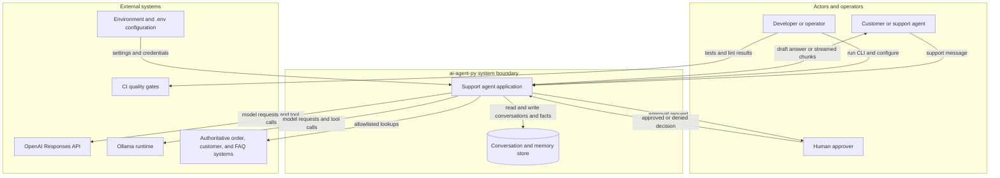

# System Context

Status: Current and target · 2026-11-24

## Purpose

This view shows what `ai-agent-py` is, who interacts with it, and which external systems it
depends on. The system boundary is the single Python application that receives a support message
and produces a validated answer.

## External interfaces

| Interface | Direction | Protocol / mechanism | Data exchanged | Current state | Control |
| --- | --- | --- | --- | --- | --- |
| Customer or support agent | In / out | CLI today; transport adapter later | Support message, answer, streamed chunks, errors | Hardcoded message today | Input validation; output sanitization |
| Human approver | Out / in | Approval gate target | Proposed consequential action, decision, approver identity | Not implemented | Mandatory before execution; audit record |
| OpenAI Responses API | Out | OpenAI SDK over HTTPS | Model request, tool schemas, model output, usage | Implemented for non-streaming; streaming broken | Timeout 30 s, SDK retries, approved provider only |
| Ollama runtime | Out | Local HTTP API via `ollama` client | Chat completion or chunks | Adapter written; dependency missing | Restrict API to trusted access |
| Business systems | Out | Tool handlers in-process today; network/DB later | Order status, customer records, FAQ results | In-memory mock data | Allowlist, strict args, no model authority |
| Conversation and memory store | In / out | SQLite file | Conversations, messages, summary, owner-scoped facts | Implemented; not wired to orchestrator | Owner scoping, parameterized queries |
| Environment / `.env` | In | `python-dotenv` | API key, model, planned provider settings | Implemented; import-time `KeyError` if missing | Secrets never logged or committed |
| CI quality gates | External check | pytest and Ruff | Test results, lint findings | Baseline failing | Release-blocking target |

## Trust boundaries

| Data | Trust level | Rule |
| --- | --- | --- |
| User support message | Untrusted input | Validate and treat as data, not instructions to internal systems |
| Model output | Untrusted result | Parse only complete responses; validate schema and business rules |
| Tool results | Untrusted data | May inform an answer; never followed as instructions |
| Conversation history and memory | Supporting context | Never authoritative for order status, permissions, or workflow state |
| Business system data | Authoritative source | Accessed only through authorized tools/application code |
| Human approval decision | Trusted control signal | Required before consequential actions; recorded for audit |
| API keys and provider credentials | Secret | Loaded from environment, redacted from logs, never committed |
| Configuration values | Controlled input | Validated at startup; unsupported provider options omitted |

## Scope exclusions

The following are outside the system boundary at this phase:

- Training or fine-tuning models.
- Building a customer-facing UI or public API product.
- Implementing the authoritative order, customer, or FAQ systems themselves.
- Providing production authentication, billing, or ticket management.
- Operating general-purpose model infrastructure; local Ollama is an external runtime.

## Current vs. target

| Aspect | Current | Target |
| --- | --- | --- |
| Entry | One-shot CLI with hardcoded message | Configurable CLI or thin transport adapter |
| User interaction | Single turn | Multi-turn conversation with memory |
| Tool grounding | Orchestrator module exists but is not wired into CLI | End-to-end tool-grounded answers |
| Provider choice | OpenAI CLI path; Ollama adapter not importable | Factory-selected approved providers behind one contract |
| Approval | Not implemented | Mandatory gate for consequential actions |
| Telemetry | Prints text and token counts | Structured metrics, logs, traces, redaction |

## Traceability

Supports `FR-01`, `FR-03`, `FR-05`, `FR-06`, `FR-09`, `FR-10`, `FR-14`, `NFR-05`, `NFR-06`,
`NFR-08`, and `BR-01`, `BR-03`, `BR-04`, `BR-08`.
