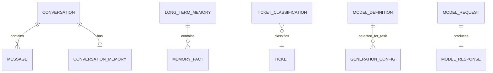

# Domain Model

Status: Current model with target gaps · 2026-11-24

## Purpose

This document defines the domain vocabulary, objects, invariants, and authority boundaries. It
describes what exists in `src/ai_agent/domain/**` and identifies target changes needed by the
discovery and architecture decisions.

## Ubiquitous language

| Term | Meaning | Source |
| --- | --- | --- |
| Ticket | Customer support message requiring classification and an answer | `TicketClassification`, `src/ai_agent/main.py` |
| Classification | Validated category, optional order ID, and lookup flag for a ticket | `domain/ticket_classification.py` |
| Conversation | Ordered messages sharing an ID and creation time | `domain/conversation.py` |
| Message | Single system/user/assistant utterance with ID and UTC timestamp | `domain/conversation.py` |
| Conversation memory | Summary and fact strings scoped to one conversation | `ConversationMemory` |
| Memory fact | Owner-scoped key/value fact with confidence, source, and timestamps | `MemoryFact` |
| Long-term memory | Owner's summary plus facts used as supporting context | `LongTermMemory` |
| Model request/response | Request/response shape used by most application services | `domain/models.py` |
| Model definition | Registered model capability and context descriptor | `ModelDefinition` |
| Generation config | Task-specific frozen generation parameters | `application/generation_config.py` |
| Tool result | JSON-serializable outcome envelope for a tool call | `tools/tool_result.py` |
| Approval decision | Target trusted record authorizing a consequential action | `FR-09`, pending ADR-007 |

## Domain objects



### `ModelRequest` — Pydantic model

**Status:** Current · `src/ai_agent/domain/models.py:4-8`

| Field | Type | Default | Constraint |
| --- | --- | --- | --- |
| `message` | `str` | required | No explicit non-empty validation |
| `instructions` | `str` | `"You are a helpful assistant."` | None |
| `model` | `str \| None` | `None` | Resolved by provider when absent |
| `max_output_tokens` | `int` | `1000` | No positive-value validation today |

### `ModelResponse` — Pydantic model

**Status:** Current · `src/ai_agent/domain/models.py:11-16`

| Field | Type | Default | Meaning |
| --- | --- | --- | --- |
| `text` | `str` | required | Complete generated text |
| `model` | `str` | required | Model that produced the response |
| `input_tokens` | `int` | `0` | Reported input usage |
| `output_tokens` | `int` | `0` | Reported output usage |
| `total_tokens` | `int` | `0` | Sum populated by the provider |

### `TicketClassification` — strict value object

**Status:** Current · `src/ai_agent/domain/ticket_classification.py:5-22`

| Field | Type | Constraint |
| --- | --- | --- |
| `category` | `Literal["order_status", "refund", "technical_support", "account", "general"]` | Exactly one known category |
| `order_id` | `str \| None` | Optional; required when `needs_order_lookup` is true |
| `needs_order_lookup` | `bool` | Lookup is only allowed for `order_status` in this application |

Model config: `extra="forbid"`, `strict=True`. Business validation is in
`application/ticket_validation.py` and currently fails to import because `LLMValidationError` is
undefined in `application/errors.py`.

### `MessageRole` and `Message`

**Status:** Current · `src/ai_agent/domain/conversation.py:7-22`

`MessageRole` is a `StrEnum` with `SYSTEM`, `USER`, and `ASSISTANT`.

`Message` is a frozen dataclass:

| Field | Type | Default |
| --- | --- | --- |
| `role` | `MessageRole` | required |
| `content` | `str` | required; non-blank enforced in `__post_init__` |
| `id` | `str` | UUID4 string |
| `created_at` | `str` | `datetime.now(UTC).isoformat()` |

### `Conversation`

**Status:** Current · `src/ai_agent/domain/conversation.py:25-29`

Mutable dataclass with `id` (UUID4), `messages: list[Message]`, and `created_at` (UTC ISO string).

**Target gap:** no `owner_id`, tenant, or authorization field. The store keys long-term facts by
owner but does not scope conversations or messages (`FR-05`, `NFR-06`).

### `ConversationMemory`

**Status:** Current · `src/ai_agent/domain/conversation.py:32-35`

Mutable dataclass with `summary: str` and `facts: list[str]`. Facts are plain strings, not
validated `MemoryFact` objects. This is supporting context, not authority.

### `MemoryFact`

**Status:** Current · `src/ai_agent/domain/memory.py:6-24`

Frozen dataclass with:

| Field | Type | Default | Invariant |
| --- | --- | --- | --- |
| `key` | `str` | required | Non-blank |
| `value` | `str` | required | Non-blank |
| `id` | `str` | UUID4 string | — |
| `confidence` | `float` | `1.0` | `0 <= confidence <= 1` |
| `source` | `str` | `"conversation"` | — |
| `created_at` | `str` | UTC ISO string | — |
| `updated_at` | `str` | UTC ISO string | — |

`owner_id` is not part of `MemoryFact`; ownership is supplied by the caller to `ConversationStore`
and enforced by `UNIQUE(owner_id, memory_key)` in storage.

### `LongTermMemory`

**Status:** Current · `src/ai_agent/domain/memory.py:27-32`

Mutable dataclass with required `owner_id`, `summary`, `facts: list[MemoryFact]`, and `updated_at`.
It groups owner-scoped supporting context but is not yet assembled into model context.

### `ModelDefinition`

**Status:** Current · `src/ai_agent/domain/model_definition.py:4-12`

Frozen dataclass with `name`, `provider`, `model_id`, `supports_streaming`,
`supports_tool_calling`, `supports_structured_output`, and `context_window`. The catalog entries
currently use placeholder IDs and `context_window=0`, so capability/context checks cannot be
trusted yet.

### Supporting design objects

These live outside `domain/` but participate in the domain design:

| Object | Module | Role |
| --- | --- | --- |
| `GenerationConfig` | `application/generation_config.py` | Frozen task generation settings |
| `PromptTemplate` | `prompts/prompt_template.py` | Frozen named/versioned template |
| `ToolResult` | `tools/tool_result.py` | Frozen tool outcome envelope |
| `ToolDefinition` | `tools/tool_registry.py` | Frozen registry entry with schema and handler |
| `ContextWindowExceeded` | `application/context_manager.py` | Context budget failure |

## Aggregates and boundaries

| Aggregate | Root | Contents | Invariants |
| --- | --- | --- | --- |
| Conversation | `Conversation` | `Message`, `ConversationMemory` | Messages have unique IDs and non-blank content; history ordered by `created_at, rowid` |
| Owner memory | `LongTermMemory` / `owner_id` | `MemoryFact` | Facts have non-blank key/value and confidence in `[0,1]`; one value per `(owner_id, key)` |
| Ticket classification | `TicketClassification` | category, order ID, lookup flag | Strict schema; lookup requires order ID and `order_status` |
| Model catalog | `ModelDefinition` | registered models | Names unique in registry; capabilities explicit |
| Tool registry | `ToolDefinition` | registered tools | Names unique; strict argument models |

**Target boundary correction:** conversations and messages must carry an authenticated owner ID;
tool execution must carry authorization and approval context. Until then, aggregates are
logical, not fully enforced.

## Lifecycle

### Ticket

```text
message → prompt → complete model result → strict parse → business validation → routing
                 ↘ retry/fallback on transient or invalid result
```

### Conversation

```text
start_conversation → add_user_message → build_context → model call → add_assistant_message
                   → update_memory / long-term fact extraction
```

### Long-term fact

```text
extract → MemoryFact(validate) → save_fact(owner_id) → upsert by (owner_id, key)
        → retrieve by owner and query → inject as supporting context
```

### Tool result

```text
model tool call → registry lookup → strict argument validation → handler
                → ToolResult(success, data|error) → returned to model as data
```

## Authority and trust

| Object | Authority level | Rule |
| --- | --- | --- |
| `TicketClassification` | Routing aid | Does not prove business facts or authorize actions |
| `Message`, `ConversationMemory`, `MemoryFact` | Supporting context | Untrusted as instructions; never authoritative |
| Authoritative tool data | Source of truth | Accessed through allowlisted tools/application code |
| `ToolResult` | Untrusted data envelope | Must not be followed as instructions |
| `ModelResponse` / complete parsed result | Untrusted until validated | Accepted only after status, schema, and business validation |
| `ApprovalDecision` (target) | Trusted control | Gates consequential actions |

## Target domain changes

1. Add `owner_id` to `Conversation` and enforce it in store queries.
2. Replace the two model interfaces with one canonical contract (`Q-12`, pending `ADR-004`).
3. Add explicit `ApprovalDecision`, `Principal`, and `ToolPermission` domain objects.
4. Add a version to `TicketClassification` or its prompt/schema pair for evaluation reproducibility.
5. Validate `max_output_tokens > 0` and generation ranges in `GenerationConfig`.
6. Replace placeholder `context_window=0` with verified provider values.
7. Consider typed tool payloads instead of raw `dict` data from mock handlers.

## Traceability

Supports `BR-01`, `BR-02`, `BR-04`, `BR-07`, `BR-08`, `FR-02`, `FR-03`, `FR-05`, `FR-06`,
`FR-09`, `FR-14`, `NFR-06`, `NFR-08`, `NFR-09`, and `ADR-001`, `ADR-002`, `ADR-003`.
