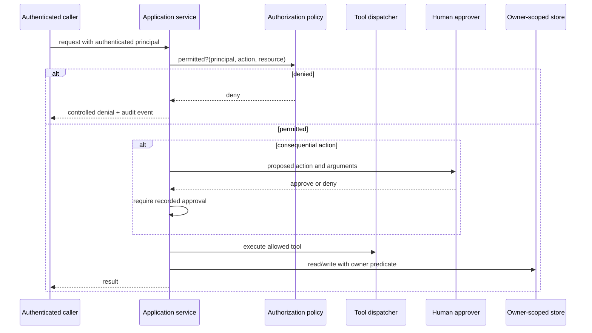

# Access Control

Status: Current gaps and target design · 2026-11-24

## Current state

| Control | Current implementation | Gap |
| --- | --- | --- |
| Authentication | None | No `Principal`, login, token, or session verification |
| Owner identity | `owner_id: str` passed to `MemoryManager` and `ConversationStore` | Caller-supplied; not derived from authenticated context |
| Conversation ownership | `conversations(id, created_at)` | No owner column; any conversation ID can be addressed |
| Message ownership | `messages(conversation_id, ...)` | Inherits unowned conversation |
| Memory ownership | `long_term_memories(owner_id, memory_key)`, unique index and owner-filtered queries | Owner is not authenticated; no cross-owner enforcement test |
| Tool authorization | `ToolRegistry` allowlist and strict argument schemas | No user/role permission check |
| Approval | Not implemented | Consequential actions are not gated or recorded |
| Audit | Not implemented | No attributable tool/approval/security decision log |
| Transport access | CLI only | No authenticated API boundary |

`ConversationStore.save_fact(owner_id, fact)`, `get_facts(owner_id)`, and
`delete_fact(owner_id, key)` use parameterized owner-scoped SQL, which prevents SQL injection but
does not prove the caller is that owner.

## Target model

Add domain objects (see `../03-design/domain-model.md` target changes):

| Object | Responsibility |
| --- | --- |
| `Principal` | Authenticated identity, tenant, roles, and permissions |
| `OwnerId` | Validated identifier derived from `Principal`, never from prompt/user text |
| `ToolPermission` | Which principal/roles may call which tool under what conditions |
| `ApprovalDecision` | Attributed approval/denial with action, arguments, timestamp, and decision |
| `AuditEvent` | Traceable record of security-relevant actions |

## Roles and permissions

| Role | View own tickets | Ask tools | View conversation/memory | Approve consequential actions | Admin |
| --- | --- | --- | --- | --- | --- |
| Unauthenticated | No | No | No | No | No |
| Customer | Own only | Allowlisted read-only lookups scoped to own records | Own only | No | No |
| Support agent | Assigned tickets | Allowlisted lookups permitted by policy | Assigned conversations only | No | No |
| Human approver | As support agent | No execution by role alone | Read proposed action context | Yes | No |
| Administrator | Policy-defined | Policy-defined | Policy-defined | Policy-defined | Yes |

Exact permissions require product/security approval. Deny by default.

## Enforcement points

| Point | Rule |
| --- | --- |
| Composition root / transport | Authenticate the caller and construct `Principal`; fail closed |
| Conversation service | Require `Principal`; scope `start/get/add/build_context` to `OwnerId` |
| Store adapter | Query with owner/conversation predicates from validated context only |
| Memory manager | Accept `Principal`, not free-form `owner_id`; retrieve only owned facts |
| Tool dispatcher | Verify tool allowlist, argument schema, principal permission, then execute |
| Orchestrator | Request approval for consequential tools before dispatch |
| Provider boundary | Send only data permitted for that principal/tenant |
| Logging/audit | Record decision and actor without sensitive values |

## Authorization flow

## Migration from caller-supplied owner

1. Add `owner_id` columns to `conversations` and `messages` as nullable, then backfill from a
   trusted source and enforce non-null later.
2. Introduce `Principal`/`OwnerId` in the application API; keep a temporary compatibility adapter
   that maps legacy callers only in development.
3. Add owner predicates to every conversation/message query.
4. Replace `MemoryManager.process_conversation(owner_id, ...)` and
   `retrieve_relevant_memory(owner_id, ...)` with principal-based signatures.
5. Add permission checks to `ToolDispatcher.execute()`.
6. Add approval gate and audit records.
7. Remove compatibility adapter once tests and callers are migrated.

Never infer `owner_id` from ticket text, tool results, model output, memory, or a URL/form field
without authentication.

## Tests

- Unauthenticated request denied at the entry boundary.
- Owner A cannot read/update/delete owner B's conversation, messages, memory, or tool results.
- Tool not in allowlist denied; tool in allowlist but not permitted for role denied.
- Consequential action denied without approval; approval by wrong role denied; approval recorded.
- Store methods reject empty/invalid owner IDs.
- Audit events include trace ID, actor, action, resource, decision, timestamp, and no sensitive
  values.
- Restart persistence test confirms owner scoping survives process restart.

## Traceability

Supports `BR-03`, `BR-08`, `FR-03`, `FR-05`, `FR-06`, `FR-09`, `FR-14`, `NFR-06`, `SR-01`,
`SR-02`, `SR-03`, `SR-05`, `SR-06`, `SR-19`, and pending ADR-006/ADR-007 in
`../02-architecture/architecture-decisions.md`.
