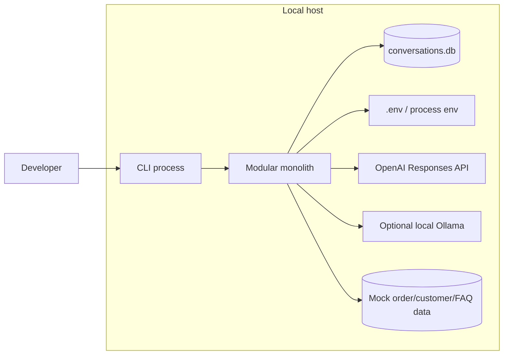
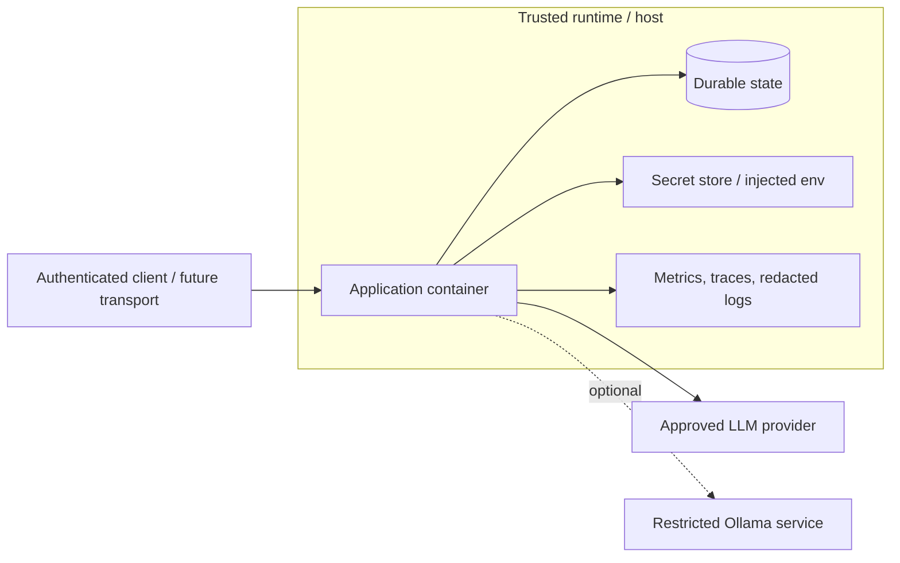

# Infrastructure

Status: Current runtime and proposed target · 2026-11-24

## Current topology

There is no provisioned infrastructure, container, service endpoint, load balancer, managed
database, secret store integration, monitoring stack, or deployment automation. The whole
application is one Python process (`ADR-001`).

## Target topology

## Runtime units

| Unit | Responsibility | Current | Target |
| --- | --- | --- | --- |
| Application process | CLI/transport, application services, providers, tools, store adapter | Present | One container/process |
| Durable state | Conversations, messages, memory | SQLite file | SQLite volume for prototype; managed DB pending ADR-008 |
| Secret store | Provider keys and future DB credentials | `.env` only | Platform secret manager |
| Provider endpoint | Generation/classification | OpenAI SDK | Approved provider(s) with capability and data-term checks |
| Ollama runtime | Local inference | Adapter written, dependency missing | Optional restricted internal service |
| Observability sink | Logs, traces, metrics | CLI stdout | Central redacted sink |
| CI/CD | Build and promote artifacts | None | See `ci-cd.md` |

## Resource profile (proposed, unmeasured)

Sizing must be measured with the evaluation harness (`work/05-evaluation/`) before approval. Start
with modest values and alert on saturation.

| Resource | Development | Staging | Production starting point |
| --- | --- | --- | --- |
| CPU | 1 vCPU | 1–2 vCPU | 2 vCPU |
| Memory | 512 MiB | 1 GiB | 2 GiB |
| Disk | 1 GiB | 5 GiB | 20 GiB plus backup |
| App instances | 1 | 1 | 1 initially; scale only after SQLite decision |
| Provider calls | Synthetic/limited | Controlled | Budget-limited by tenant |
| Concurrency | Single CLI run | Smoke traffic | Measured from tests |

Do not scale horizontally against a single writable SQLite file. Decide managed DB and multi-instance
support in ADR-008 before increasing replicas.

## Network rules

| Path | Rule |
| --- | --- |
| Client → app | Authenticated transport only, once a service endpoint exists |
| App → LLM provider | HTTPS to approved endpoint; no keys in logs/URLs |
| App → Ollama | Internal/restricted network only; never public |
| App → business data | Authorized integration; mock data only today |
| App → observability | Redacted metrics/logs; no raw sensitive payloads |
| App → state | Private network/mount; least privilege |

Default deny egress. Allow only what the selected provider/runtime requires. Ollama has no API key
in the current adapter and must be protected by network policy or an auth proxy.

## Data and persistence

- Current SQLite schema is in `src/ai_agent/application/conversation_store.py`; see
  `database-migrations.md`.
- Enable `PRAGMA foreign_keys = ON` on every connection (already done).
- Back up before every migration and before production release.
- Define retention, deletion, residency, and encryption requirements; they are not implemented.
- PII and memory retention rules come from `../06-security/pii-protection.md`.
- Owner scoping is a deployment gate, not optional configuration.

## Availability and failure handling

| Failure | Current behavior | Target |
| --- | --- | --- |
| Missing config | `KeyError` at import | Friendly startup error, deployment fails |
| Provider outage | SDK error converted to generic `RuntimeError` | Bounded retry, normalized error, alert, no silent fallback |
| Tool failure | Broad `except Exception` | Typed error, redacted log, controlled response |
| DB failure | SQLite exception | Health/readiness failure; no partial writes without transaction |
| Ollama unavailable | Not wired | Startup/capability check; explicit disabled state |
| Bad migration | Manual recovery | Pre-migration backup + rehearsed rollback |

## Observability requirements

- Trace IDs on model, tool, retry, context, approval, and migration events.
- Metrics: request/ticket latency, tokens, cost, tool outcome, retries, error class, approval decision.
- Alerts: error rate, latency, cost anomaly, approval failure, backup failure, migration failure.
- Logs must never contain secrets, full prompts with PII, or raw model/tool payloads.
- Evaluation evidence links release version, provider, model, prompt, profile, and dataset.

## Environments

| Environment | Purpose | Data | Promotion |
| --- | --- | --- | --- |
| Development | Local implementation | Synthetic | Developer |
| CI validation | Automated checks | Fixtures | Every PR |
| Evaluation | Frozen quality/safety measurement | Sanitized dataset | Tagged candidate |
| Staging | Operational rehearsal incl. migration/rollback | Sanitized | Approved RC |
| Production | Real traffic | governed | G5 + sign-off |

## Decision gaps

- ADR-004: canonical model contract (`Q-12`).
- ADR-005: provider fallback policy.
- ADR-006/ADR-007: authentication/authorization and approval architecture.
- ADR-008: SQLite vs. managed database and multi-instance strategy.
- Owner/platform approval required for cloud provider, sizing, retention, and residency.

## Traceability

Supports `BR-09`, `FR-15`, `NFR-05`, `NFR-06`, `NFR-08`, `NFR-11`, `NFR-12`, `NFR-13`, and
`../04-implementation/release-checklist.md`.
