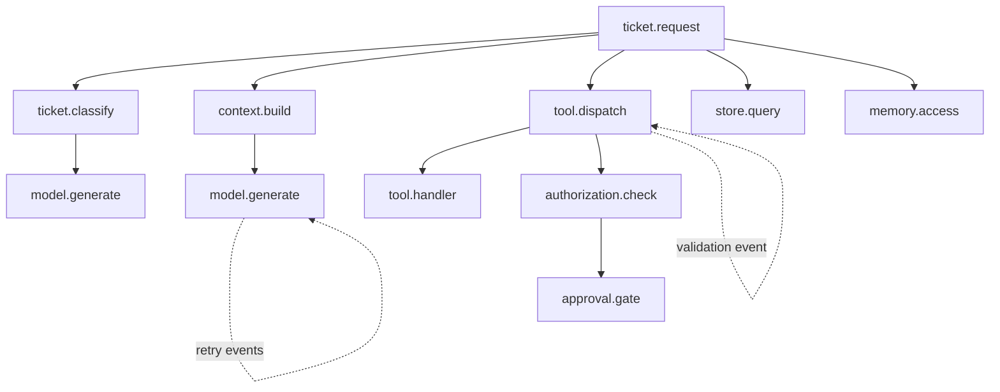

# Tracing

Status: Target design · No tracing exists today

## Current state

There is no trace context, span, trace ID, or span ID. The CLI is a single one-shot path; model,
tool, retry, context, store, and approval work cannot be correlated across logs, metrics, or
evaluation outputs. No standard trace headers are accepted or emitted.

## Target trace model

| Concept | Use |
| --- | --- |
| `trace_id` | One end-to-end ticket/request |
| `span_id` | One operation within that request |
| `parent_span_id` | Causality |
| `attributes` | Low-cardinality, redacted facts only |
| `events` | Attempts/decisions inside a span (`retry`, `denied`, `approval`) |
| `status` | `ok`, `error`, `unset` with normalized error class |

Trace context is created at the transport/composition boundary and injected into logs, metrics
exemplars, evaluation records, and incident notes. Internal calls stay in-process; use standard
trace header names if a service transport is added.

## Span catalog

| Span | Key attributes | Notes |
| --- | --- | --- |
| `ticket.request` | channel, outcome, tenant hash, revision | Root span |
| `ticket.classify` | category, confidence, profile, outcome | Separately timed from response generation |
| `context.build` | limits, retained/dropped counts, token counts | No message text |
| `model.generate` | provider, model, profile, attempt, tokens, finish_reason | One span per call/retry |
| `tool.dispatch` | tool_name, validation_result, outcome | No raw args/results |
| `authorization.check` | control, decision, tenant hash | Emits denied event |
| `approval.gate` | action class, requester/approver roles, decision | No consequential payload |
| `store.query` | operation, owner_match, row count, outcome | No SQL values/results |
| `memory.access` | operation, key hash, owner_match, outcome | No stored value |
| `migration.apply` | version, name, outcome | Deployment span, separate from request |

## Sensitive data rules

Do **not** put these in span attributes/events:

- secrets, credentials, auth headers, keys;
- ticket text, prompts, system prompts, model outputs, summaries, memory values;
- tool arguments/results, retrieved documents, raw exception bodies;
- raw owner/customer IDs, emails, phone numbers, addresses, or order details.

Allowed: hashes/approved IDs, enums, counts, durations, token counts, model/provider/tool IDs,
versions, outcomes, and normalized error classes. Redaction happens before the span is exported.

## Sampling

| Environment | Sampling |
| --- | --- |
| `dev` | 100% |
| `ci` / `evaluation` | 100%; every fixture traced and linked to results |
| `staging` | 100% for rehearsals |
| `prod` | Proposed head sampling rate approved by owner; always keep errors, denials, approvals, migrations, and sampled slow traces |

Sampling rate, retention, and storage cost require approval. An unmeasured rate is not a default;
start with full tracing in non-production and decide production sampling with cost evidence.

## Correlation

| From | To | Key |
| --- | --- | --- |
| Log/event | Trace | `trace_id`, `span_id` |
| Metric exemplar | Trace | `trace_id` |
| Evaluation result | Trace | `trace_id`, dataset version |
| Alert | Trace/log examples | `alert_id`, `trace_id` |
| Incident | Evidence set | incident ID, trace IDs, release revision |

## Instrumentation plan

1. Create a trace at the composition/transport boundary before configuration-dependent work.
2. Pass an explicit context object through application services; do not use ambient global state.
3. Instrument model port/adapters, classifier, context manager, tool dispatcher, store adapter,
   approval gate, and migration runner.
4. Add normalized error classification and retry events inside spans.
5. Export through a configurable, optional tracer; unit tests use an in-memory recorder.
6. Remove tracing from the hot path if export fails; record a local WARN with redacted fields.

## Tests

- One root trace per request and one child span per catalog operation.
- Parent/child relationships and durations correct for nested model/tool flows.
- Retry attempts appear as events/child spans with the same `trace_id`.
- Trace IDs appear in structured logs and evaluation outputs.
- Sensitive-data test with fake secrets/PII asserts absence from all exported spans.
- Error traces are always retained under the proposed sampling policy.
- Exporter failure does not break a ticket response.

## Traceability

Supports M-03, M-04, M-05, M-07, M-10, M-11, M-12, `NFR-08`, `SR-17`, and
`../08-operations/monitoring.md`.
