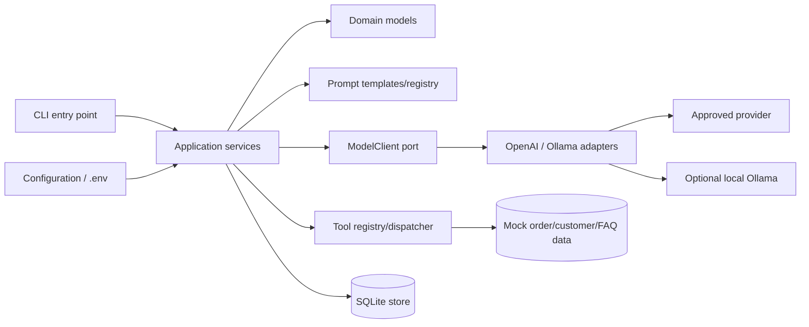

# Architecture

Status: Current structure and target direction · 2026-11-24

The chosen shape is a **modular monolith**: one Python process containing layered modules, with
external LLM providers, a SQLite store, and controlled tools outside the core (`ADR-001`).

## Overview

## Layers

| Layer | Packages | Responsibility | Rule |
| --- | --- | --- | --- |
| Entry point | `src/ai_agent/main.py` | Composition and CLI output | No business logic |
| Application | `src/ai_agent/application/` | Orchestration, classification, conversation, memory, retry, parsing | No SDK/env reads; depend on ports |
| Domain | `src/ai_agent/domain/` | Requests, responses, tickets, conversation, memory, model definitions | No infrastructure imports |
| Prompts | `src/ai_agent/prompts/` | Versioned templates, registry, builder | No provider logic |
| Providers | `src/ai_agent/providers/` | OpenAI/Ollama translation, errors, usage | Implement the canonical port |
| Tools | `src/ai_agent/tools/` | Allowlist, strict schemas, dispatch, handlers | Validate before execution |
| Configuration | `src/ai_agent/config.py`, `config/` | Settings, profiles, model catalog | One importable package; no secrets in code |
| Store adapter | `application/conversation_store.py` | SQLite persistence | Owner-scoped queries; migrations external |

## Key flows

### Implemented CLI path

1. `main()` constructs `OpenAIProvider()`.
2. `CustomerSupportAssistant(model_client=...)` builds `ModelRequest` with support instructions.
3. `OpenAIProvider.generate()` calls the Responses API and normalizes text/usage into
   `ModelResponse`.
4. `main()` prints the answer and token counts.

### Classification path (partial)

`classify_ticket()` builds a prompt → calls the model port → `parse_ticket_classification()` →
`validate_ticket_classification()` → `TicketClassification`. Complete responses only; partial
streamed JSON must never be trusted.

### Target orchestration path

Ticket → injected prompt builder → model port → parser/validator → allowlisted tool → tool facts →
domain result → human approval for consequential actions. The composition root injects every
dependency; the orchestrator does not construct SDK clients, read keys, embed prompts, or access
storage directly.

### Conversation and memory

`ConversationManager` persists messages and builds context via `ContextManager`.
`MemoryManager` summarizes, extracts, stores, and retrieves owner-scoped facts. Memory and history
are supporting data, never authoritative business state. Owner IDs must come from authenticated
context; retrieved content is untrusted data, not instructions.

## Accepted decisions

| ADR | Decision | Code status |
| --- | --- | --- |
| ADR-001 | Modular monolith | Structure exists; SDK/env coupling remains |
| ADR-002 | LLM-based ticket classification via model port | Classifier still constructs OpenAI/reads env |
| ADR-003 | Validated structured output | Schema/parser exist; validation import and stream broken |

Pending: ADR-004 canonical model contract; ADR-005 provider factory/fallback; ADR-006 identity and
owner scoping; ADR-007 approval workflow; ADR-008 persistence/migrations; ADR-009 observability.

## Current architecture violations

- Two incompatible contracts: string-based `ModelClient` vs. `ModelRequest`/`ModelResponse`.
- `config.py` shadows `config/`, so profiles/catalog cannot be imported.
- `AgentOrchestrator` constructs `OpenAI`, reads `OPENAI_MODEL`, embeds prompts, and builds its own
  tool registry.
- `OpenAIProvider.stream()` lacks `Iterator`, uses undefined `self.model`, and does not iterate/yield.
- `ticket_validation.py` references undefined `LLMValidationError`.
- `ollama` is imported but not declared in `pyproject.toml`.
- No provider factory, owner scoping, approval gate, or DI composition root.

## Code map

| Path | Contents |
| --- | --- |
| `application/assistant.py` | `CustomerSupportAssistant`, `Assistant` |
| `application/orchestrator.py` | `AgentOrchestrator` |
| `application/ticket_classifier.py`, `response_parser.py`, `ticket_validation.py` | Classification path |
| `application/conversation_*.py`, `context_manager.py` | Conversation/context |
| `application/memory_*.py`, `llm_memory_summarizer.py` | Memory path |
| `domain/models.py`, `ticket_classification.py`, `conversation.py`, `memory.py` | Domain models |
| `prompts/` | Prompt template/registry/builder |
| `providers/` | `OpenAIProvider`, `OllamaProvider` |
| `tools/` | Registry, dispatcher, executor, schemas, mock handlers |
| `config.py`, `config/` | Settings, generation profiles, model catalog |

## Extending safely

- Add new providers as adapters behind the canonical port; do not add SDK imports to application/
  domain code.
- Add tools to the registry with strict Pydantic arguments; never execute model-named tools that
  are not registered.
- Add cross-cutting concerns (auth, tracing, approval) at the composition/application boundary.
- Record boundary changes as ADRs and update `../03-design/domain-model.md`.

## Deeper reading

`../02-architecture/README.md`, `system-context.md`, `container-diagram.md`,
`component-diagram.md`, `data-flow.md`, `architecture-decisions.md`, and `adr/`.
